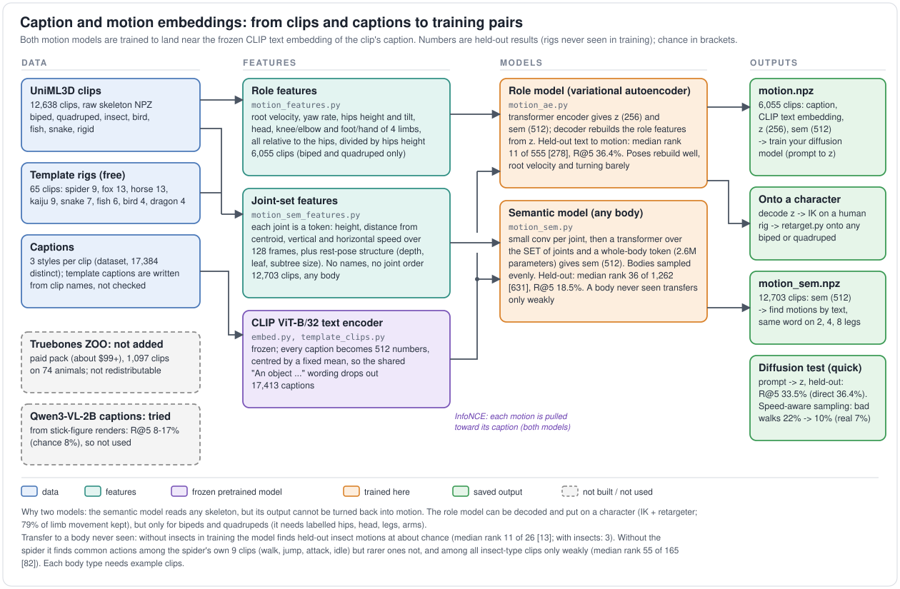
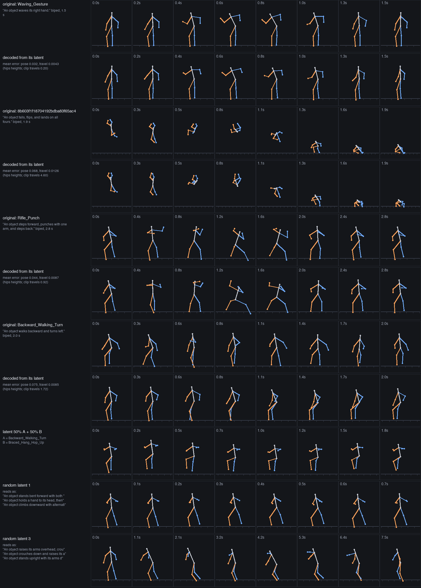
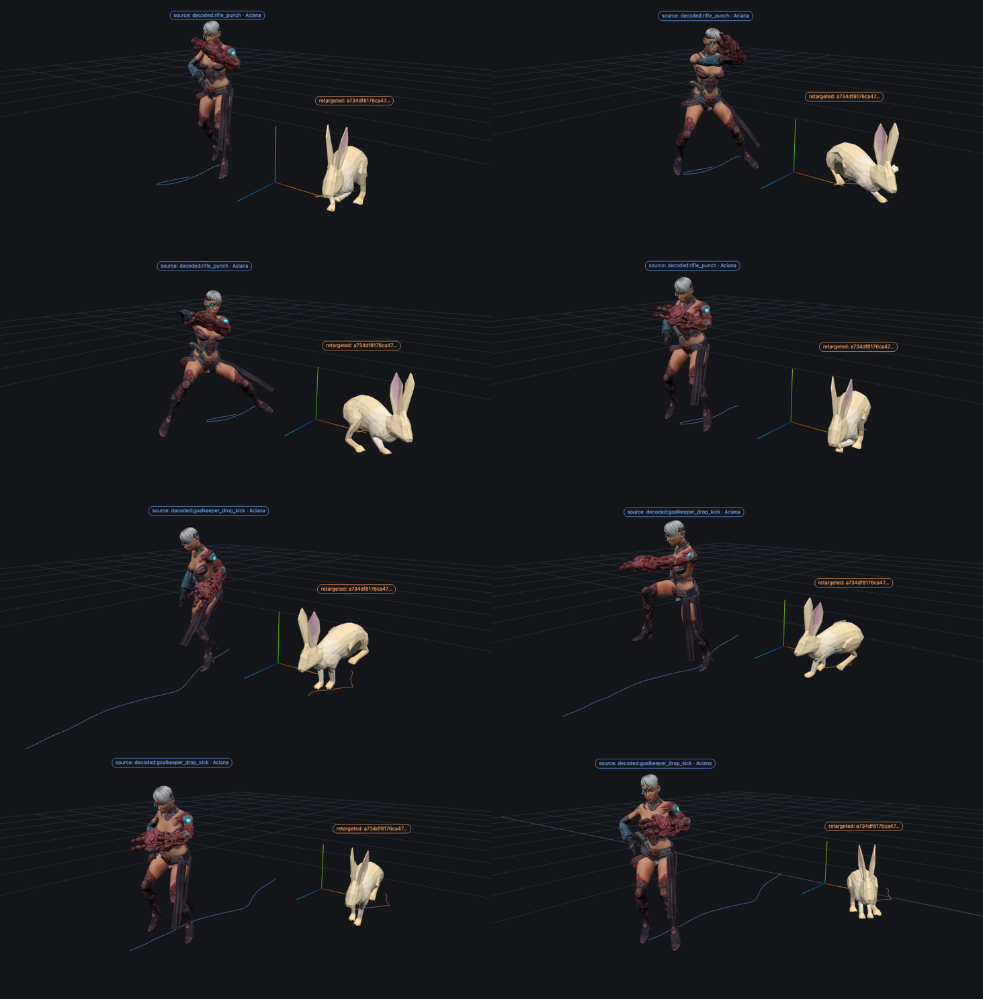
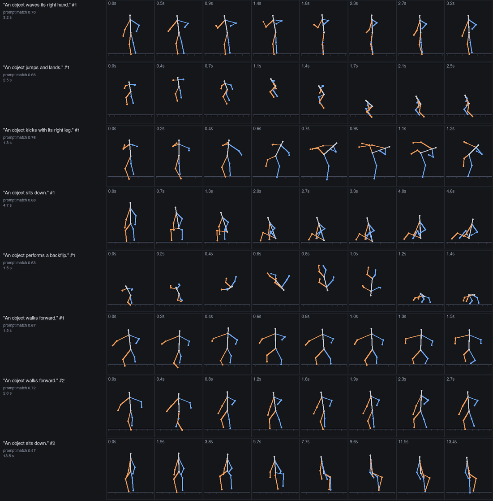
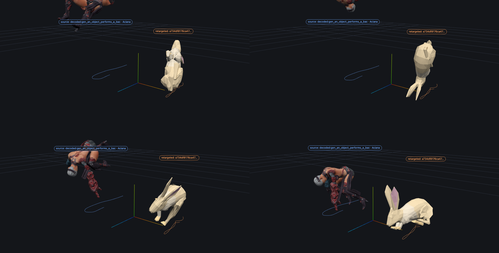
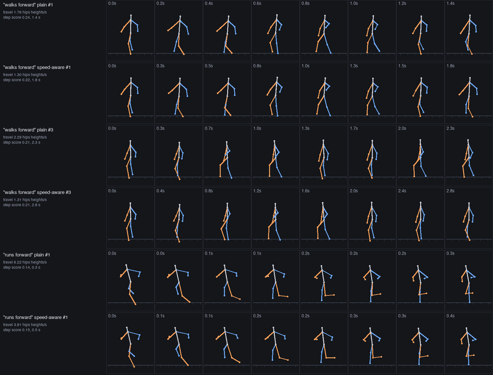

# Caption and motion embeddings



*Diagram: `docs/embed_pipeline.svg`, drawn by `scripts/tools/make_embed_diagram.py` (edit the numbers there and rerun).*

Built 2026-10-20. Goal: pairs of (text prompt, motion embedding) to train a generator on (a diffusion model), where the
embedding of a motion means the same thing whatever the body: "walk" should be near walking on 2 legs, 4 legs, 8 legs.
There are two motion models, because "semantic" and "decodable" need different inputs:

| | Semantic model (`motion_sem.py`) | Role model (`motion_ae.py`) |
|---|---|---|
| Body | any rig: biped, quadruped, insect, bird, fish, snake, rigid | biped and quadruped only (needs labelled hips, head, legs, arms) |
| Clips | 12,703 (12,638 dataset clips with a caption + 65 template clips) | 6,055 |
| Input | a set of joint tokens, no names, no order (`motion_sem_features.py`) | fixed role features of the body (`motion_features.py`) |
| Output | `sem`: 512 numbers aligned with CLIP text | `sem` (512) and `z` (256), and a decoder from `z` back to the features |
| Use | retrieval by text, conditioning, cross-body meaning | the latent a diffusion model can generate and the decoder can turn into motion |

Both are trained with InfoNCE towards the frozen CLIP ViT-B/32 text embedding of the clip's captions.

## Text side (`scripts/text/embed.py`)

- Encoder: OpenAI CLIP ViT-B/32, text tower (63M parameters), frozen. Weights are in the Hugging Face cache
  (`openai/clip-vit-base-patch32`, downloaded on first use). `CLIPTextModelWithProjection` returns embeddings that are NOT
  normalized (norms 9-11); we L2-normalize.
- Captions: the dataset's three styles per clip (`caption`, `generic`, `detail`), 35,404 captions, 17,384 distinct, none cut
  by CLIP's 77-token limit. `data/embeddings/text.npy` holds the distinct ones, `text_index.csv` maps (dataset, clip, style)
  to a row. Every caption starts with "An object", which makes raw cosines high everywhere (mean 0.89), so everything
  downstream subtracts the mean caption embedding (`text_meta.json`, recomputed from `text.npy`) and re-normalizes.
- `python3 scripts/text/embed.py --query "runs"` ranks clips by caption similarity (best of a clip's captions);
  `retarget.py --query` uses it now (keyword match as fallback). "runs" returns running clips, not the Mixamo roll that is
  named `Running`; rare words fail ("saunters" returns flinches and nods), CLIP's text tower does not know them.

## Semantic model (any body)

Features (`scripts/motion/motion_sem_features.py` -> `sem_feats.npz`): read from the raw clip NPZ, forward kinematics in the source
units (Y up). All lengths are divided by the body size S (largest extent of the rest pose). Nothing depends on which way the
character faces or on joint names.
- per joint and frame: height above the lowest point reached, horizontal distance from the body centroid, vertical speed,
  horizontal speed (S per second);
- per joint, static: rest height, rest radius, depth in the tree, number of children, leaf flag, subtree size, bone length, root flag;
- per frame, whole body: centroid height and speeds, yaw rate of the body's long axis, mean joint radius;
- per clip: log duration, log time-warp, joint count, leaf fraction, rest extents, fps.
Timeline 128 frames: shorter clips keep their timing (padded), longer ones are resampled (the warp is a scalar input).

Model (`motion_sem.py`): a small temporal conv per joint (shared), static descriptor added, then a transformer over the SET of
joints plus a whole-body token (2.6M parameters); a linear head gives 512 numbers. Bodies are sampled evenly (biped /
quadruped / other) so the 572 training clips of other bodies and the 594 of quadrupeds are not drowned by 11,000 bipeds. 60 epochs, AdamW, OneCycle, batch 96.
Negatives whose caption is within centred CLIP cosine 0.6 of the positive's are masked (many clips share a caption).

Held out: ~10% of Objaverse rigs and of Mixamo clip families (so the same motion or the same rig is never on both sides):
1,262 clips. Text -> motion retrieval, caption style `caption`:

| Gallery (held-out clips of) | n | R@1 | R@5 | R@10 | median rank | chance median |
|---|---|---|---|---|---|---|
| all | 1262 | 5.7% | 18.5% | 26.0% | 36 | 631 |
| biped | 1180 | 5.7% | 18.5% | 25.8% | 35 | 590 |
| quadruped | 30 | 10.0% | 43.3% | 70.0% | 6 | 15 |
| other bodies | 52 | 13.5% | 46.2% | 61.5% | 6 | 26 |

Motion -> text on all 1262: R@1 18.7%, R@5 30.4%, median rank 29. (Higher than text -> motion because clips with an identical
caption tie rather than count as errors; read it as optimistic.) The quadruped and other-body sets are tiny, so those rows are
noisy. (These are the final model, retrained with the 65 template clips; the numbers before them were within 1-2 points.) Held-out accuracy stopped improving around epoch 40 while the training loss kept falling (mild overfitting).

Same word, different bodies (`motion_sem.py --query "walks" "runs" "jumps" "flies"`, over all clips, training ones included):
"walks" returns walking motions on bipeds, quadrupeds, insect rigs ("walks in place") and birds; "jumps" and "leaps" on all
four; "flies" returns wing-flapping on birds, insects and fin-flapping on marine rigs. Where a body has no such clip (no
running insect, no walking snake) the nearest thing comes back ("scuttles", "crawls forward, inching its segmented body").
This is a qualitative check, not a held-out number.

Does the meaning transfer to a body never seen? `--holdout-class insectoid` trains without any of the 156 insect clips:
- all 156 insect clips, text -> motion within them: R@5 16.7% (chance 3%), median rank 44 (chance 78): some transfer;
- the 26 insect clips held out in both runs: trained with insects median rank 3 (R@5 65%); trained without them median rank 11
  of 26 (R@5 31%), about chance (13). **So words alone do not carry the meaning across bodies at this data size; the model
  needs examples of each body.** Birds were not tested (11 held-out clips).

Body information in the embedding: a linear probe separates biped / quadruped / other from `sem` with 83% balanced accuracy
(chance 33%), and from the CLIP text of the captions alone with 80%. The embedding leaks no more body information than the
captions it is trained on; phrases like "flaps wings" or "on four legs" name the body. It is not body-free.

**Does an 8-legged body get understood without examples? (`--holdout-object spider`)** A copy trained without the 9 spider clips, then
asked to find each spider clip from its own caption (the model never saw a spider):

| Gallery | trained without the spider | trained with it (training clips, memorized) | chance |
|---|---|---|---|
| the 9 spider clips | exact match for 4 of 9, top 3 for 5 of 9, median rank 1 | 8 of 9, top 3 for 9 of 9, median rank 0 | median rank 4 |
| the 165 insect-type clips | top 10 for 2 of 9, median rank 55 | 9 of 9, median rank 0 | median rank 82 |

Common actions carry over (Walk, Jump, Attack, Idle are found among the spider's own clips), rarer ones do not (Bite, Death, Eating, Hit
rank 5-7 of 9). Against the other insect-type clips it is weak: the spider Walk ranks 13 of 165, Jump 0, Attack 2, the rest 19-132. The
ranking among all 12,703 clips is not a fair test (thousands of other bodies "walk forward" and are correct matches). Nine clips with
captions taken from names is a small, noisy test; read it as: some transfer for common actions, not enough to rely on for a new body.

## Role model (decodable latent)

Features (`motion_features.py` -> `motion_feats.npz`, 41 per frame): root velocity and yaw rate in the heading frame, hips height above the clip's
lowest foot joint (changed on 2026-10-20, see "Why walking looked weak"), hips tilt (6D), head, and knee/elbow and foot/hand of the 4 limbs relative to the hips, all divided by the hips height. Needs
the labelled roles of `retarget.py`, so 1,170 clips (rigs with no hips/head, no legs, or head not below hips) and about 60 unconverted
clips are missing: 6,055 clips (5,786 biped, 269 quadruped). Timeline 128 frames as above.

Model (`motion_ae.py`): transformer VAE (z = 256, KL weight 1e-4) with the same contrastive head on `sem`, plus a decoder from `z`
and a small head for duration. 150 epochs. Held out (555 clips: 550 biped, 5 quadruped, so no quadruped result):

| | |
|---|---|
| text -> motion | R@1 15.3%, R@5 36.4%, R@10 47.6%, median rank 11 of 555 (chance 278) |
| motion -> text | R@1 27.6%, R@5 47.0%, median rank 6 |

Reconstruction from the mean latent on held-out clips, mean absolute error vs predicting the training mean (H units, radians):
hips height 0.044 (0.139), limb joints 0.060 (0.147), head 0.047 (0.130), hips tilt 0.035 (0.081), **root velocity 0.0084
(0.0107), yaw rate 0.038 (0.041)**. (First version of the features, before the hips-height fix: R@5 35.5%, median rank 10, hips height 0.059 (0.177); kept as `*_v1` files.) Pose and height are captured; the per-frame travel and turning numbers are barely better than the mean. The decoded
output is role-space features, not joint rotations; the IK step below turns it into an animation on a character.

### What the decoder produces (drawn, 2026-10-20)

`python3 scripts/motion/decode_latents.py` decodes latents and draws them as stick figures (hips, head, a chest point for the arms, knee/foot,
elbow/hand; left blue, right orange; hips path = integrated root velocity and yaw). Full sheet: `figures/decoded_latents.png` (25 strips),
compact: below.



- **Held-out clips, encoded then decoded** (9 clips, one per action word): in the compact figure a wave, a rifle punch and a fall-flip-land follow
  the original closely; the backward-walking turn keeps some stepping but not the arm swing (with the first version of the features it came out nearly
  frozen). In the full sheet, as before, a hang-and-hop is flatter and a quadruped-rig clip keeps its stance but loses an arm reach.
- **Over all 555 held-out clips** (limb-joint spread over time, decoded / original; 1 = same, 0 = frozen): median **0.79**, below 0.5
  for 22% of clips. Walk and run captions do slightly better (median 0.85, 15% below 0.5, n=178) than the rest (0.76, 26%, n=377). Root travel (sum of forward speed, clips
  travelling more than 0.3 hips heights, n=255): median 0.71 kept (walk/run 0.93, n=89), below 0.5 for 15%. This measures amplitude, not whether the phase of a step is right.
- **A straight line between two latents** (a walking turn and a hang-hop) decodes to smoothly changing, plausible poses at 75 / 50 / 25%.
- **Random latents** from a Gaussian fitted to the training latents (what a diffusion model would hand to the decoder), 4 samples: all give
  plausible, anatomically sensible poses (no collapsed or exploded limbs); their `sem` head reads the two shown as "stands bent forward with both [arms]" / "holds a hand to
  its head" and "raises its arms overhead, crouches", which matches what is drawn (the second raises its arms and crouches).
- **Not shown:** this is a stick figure drawn from role features, not a character: the arms start from a chest point at 75% of the spine and
  the legs from the hips, hips tilt is not drawn, and nothing here has gone through IK or a skeleton. It says the latent decodes to
  believable motion, not that an animation on a rig works.

### Decoded latents on a character (the IK step, 2026-10-20)

`scripts/generate/decoded_to_character.py` puts a decoded latent on a rigged character in two stages. **Stage 1** turns the decoded role features into a
clip on the Mixamo reference skeleton (22 joints): the hips follow the integrated root velocity, yaw and tilt; the spine is bent so the head lands
where the features put it; each limb is solved with two-bone IK to the decoded foot/hand, bending towards the decoded knee/elbow; the hips are placed so the lowest
foot stands at the proxy's ankle height (the features measure hips height above the lowest foot), and legs are not stretched. **Stage 2** runs that human clip through `retarget.py` (foot contacts, pinning,
ground fix) onto the chosen character, as for any dataset clip, and saves `rt__dec_<label>.glb` beside it, so `viewer/compare.html` lists it
(the human proxy on the left, the character on the right). `--selftest` checks stage 1; `--examples` decodes the 9 example latents and writes them on
`mixamo_Aciana` (biped) and the rabbit-like stand-in quadruped (`objaverse_a734...`); the proxy clips are in `data/decoded/`.

- **Stage 1 on real clips** (8 Mixamo clips: features -> IK -> features again, mean absolute error in hips heights or radians, mean-prediction baseline in
  brackets): root velocity 0.0011 (0.0224), yaw rate 0.0024 (0.0231), hips height 0.0027 (0.1015), hips tilt 0.0025 (0.0701), limb joints 0.0142 (0.1329),
  head 0.0352 (0.0710). The root path is reproduced almost exactly; the head is the weakest (one bend cannot copy every neck curl).
- **The 9 decoded latents on both characters** (6 held-out clips, 3 random latents; retargeter's own metrics; rerun with the corrected features): 13 of 18 runs have 0
  reach-failure frames; the others are the flip on the rabbit (9 frames; the same clip penetrates the floor by 86 mm on the human), one random latent (21 frames on both characters,
  71 mm penetration on the rabbit) and another random latent (1 frame on both). Foot sliding at most 0.014 m/s, body lift at most 0.12 m. (The first version of the features gave 18 of 18 clean runs; see the trade-off in
  "Why walking looked weak".)
- **Looked at** (viewer, front/three-quarter view): the decoded rifle punch is a recognizable lunge and punch on the human, and the decoded goalkeeper
  kick is a stepping kick with a raised knee and travel; the rabbit gets a body-motion version of each (crouch, rise, lean, hop along the path), not a
  copy of the arms. The metrics were not enough on their own: only these two (plus the sheet below) were checked by eye.



Limits: the decoded motion carries the decoder's errors (above) into the animation; only two characters were tried (the long-bodied quadrupeds that were
hard for the retargeter in `RETARGET.md` were not); hands and feet have no finger or toe motion; the foot is kept at its rest orientation by the proxy,
and the retargeter's flat-foot rule takes over on pinned frames; random latents often decode to nearly still poses (2 of 3 here), so a diffusion model that
generates such latents would give some static clips; this is a rule-based pipeline, not a learned decoder onto a rig.

## Diffusion test: prompt -> latent -> motion (quick, 2026-10-20)

`scripts/motion/diffusion_test.py` trains a text-conditioned diffusion model on the saved pairs, using only the 5,500 training clips: a residual MLP
denoiser (28.5M parameters, 4 blocks, width 1024) that predicts the noise on `z` (256, standardised) given the CLIP caption embedding (one of the
clip's three caption styles per step; text dropped 10% of the time for classifier-free guidance), DDPM with a cosine schedule, 8,000 steps of batch 256
(about 9 minutes on MPS, loss 1.34 -> 0.15), sampled with DDIM (50 steps). Evaluated on the 555 held-out clips (rigs and clip families never seen), with
the caption of each as the prompt. This is a feasibility test, not a tuned generator: one training run, one seed, no hyperparameter search.

| Guidance | generated -> its real held-out clip: R@1 / R@5 / R@10, median rank | prompt-match cosine | Frechet distance to held-out latents | same-prompt diversity | distance to nearest training latent |
|---|---|---|---|---|---|
| 1 | 7.7% / 25.8% / 38.7%, 18 | 0.55 | 49 | 0.440 | 11.3 |
| 2 | 11.0% / 33.5% / 47.4%, 11 | 0.66 | 102 | 0.166 | 11.3 |
| 4 | 13.9% / 36.6% / 49.4%, 10 | 0.69 | 174 | 0.069 | 12.5 |
| reference | direct text -> motion retrieval with the semantic head: 15.3% / 36.4% / 47.6%, 11 | real pair 0.396, other clip 0.081 | train vs held-out real: 62 | real clips with near-identical captions: 0.427 | real held-out: 6.71 |

How it is measured: a generated latent is read with the role model's semantic head `sem` (a function of `z`), compared with the prompt (cosine), and used
to look up the nearest REAL held-out motions (rank of the clip the prompt came from). Diversity is the mean pairwise cosine distance of `sem` over 8 samples of one
prompt (40 prompts), against 8 real training clips whose captions are nearest to the prompt. Frechet distance is on standardised latents (555 vs 555 in 256 dimensions,
so the absolute values are biased high; compare rows, not to zero).

What it shows:
- **The prompt gets through.** With guidance 4 the generated latent finds its clip as well as direct retrieval does (R@5 36.6% vs 36.4%); the diffusion model learned the
  text -> latent relation to about the level the contrastive head already encodes, not beyond it. Without guidance it is weaker (R@5 25%).
- **Guidance trades realism and diversity for adherence.** From 1 to 4, prompt match and retrieval rise, but the Frechet distance rises from 49 to 174 and the diversity
  falls from 0.44 (as varied as real clips with the same caption, 0.43) to 0.07 (nearly one answer per prompt). Guidance about 1-2 is the usable range if variety matters.
- **Not a lookup of the training set.** Generated latents lie farther from every training latent (11-12) than real held-out latents do (6.75), so they are not copies of training clips;
  the same gap also says they sit somewhat off the real-latent distribution.
- **They move like real clips.** Decoded with the role decoder (guidance 2): limb movement median 0.048 vs 0.054 for real held-out clips; 17% of generated clips move
  less than 40% of the real median, against 17% for real clips. No collapse to still poses.

(The table is for the model retrained on the corrected features; the first version gave the same picture to within about a point: guidance 2 R@5 33.9%, Frechet 106, diversity 0.161.)

Looked at by eye (6 prompts, 2 samples each, guidance 2; `figures/diffusion_samples.png`, the compact figure below shows 8 of the 12): a wave raises and waves the
right arm; a jump rises and lands in a crouch; a right-leg kick swings the right leg up with the body leaning back; "sits down" sinks to a seated posture in one sample and
is a slow 13.5 s shuffle in the other; a backflip rises, tumbles and lands curled; and both "walks forward" samples step with alternating legs (one holds its arms out, one
swings them). The first sample of each prompt was also put on the human and the rabbit-like quadruped through the IK step: all 12 runs have 0 reach-failure frames except
"sits down" on the rabbit (96 frames). (With the first version of the features the "walks forward" samples looked weak; see the next section.)





Limits: the retrieval and prompt-match numbers use the same `sem` head that shaped the latents, so they say the latent reads as the prompt, not that the decoded motion looks like it;
that is only checked by eye on 12 samples of 6 prompts I chose. The prompts are held-out clips' own captions, in the phrasing of the training captions; free phrasings
("saunters") are not tested. The decoder keeps about 79% of the limb movement. One model, one seed per version. The quadruped targets are one rabbit-like stand-in.

## Why walking looked weak (diagnosed, partly fixed, 2026-10-20)

In the first diffusion samples "walks forward" looked weak. Looking at two samples was misleading; measuring it (`scripts/motion/gait_check.py`, `scripts/motion/walk_check.py`) showed:

- **The pipeline can walk.** For ordinary walking clips the autoencoder keeps the gait: reconstructions step as strongly as the originals (step score 0.213 vs 0.203 on
  285 training clips, 100% of held-out ones still stepping), and for forward-travelling walks the travel and foot cycle match (1.07 vs 1.04 hips heights per second, 0.76
  vs 0.76 Hz). The step score is the foot swing times how much the two feet alternate (see `gait_check.py`). A "stands still" prompt scores 0, as it should.
- **But some generated walks were bad.** A walk is called bad if the hips float, it travels faster than 2.5 hips heights per second, or it does not step. Real forward-walking
  clips are bad 7-10% of the time by this rule; generated ones 33% (guidance 2, from 155 real walking captions) and 21.5% (200 samples of "An object walks forward.").
- **Largest cause: a data artifact, not the walking.** In 12% of the biped training clips the whole skeleton sits about one hips height above where the rest pose puts it
  (clip hips at 1.6-2.8 hips heights while the rest hips are at 0.5-1.0; the head is lifted by the same amount; looks like the rest height counted twice for those
  Objaverse rigs; velocities are unaffected). `motion_features.py` divided the absolute hips height by the rest hips height, so these clips became a "floating" mode that the
  model learned and generated in 13-29% of walks.
- **Fix:** hips height is now measured above the clip's lowest foot joint (`FLOOR_FROM_FEET` in `motion_features.py`), which cancels a constant vertical offset. The share of
  biped clips with hips height above 1.1 fell from 11.4% to 1.4%. The role model and the diffusion model were retrained on the corrected features (the old files are kept as `*_v1`).

Bad-walk rate, walks generated from the 155 real forward-walking captions (n=155, real clips: 7.1% on the corrected scale, 9.7% on the old):

| | floating hips | too fast | not stepping | any |
|---|---|---|---|---|
| first version, guidance 2 | 20.0% | 7.1% | 12.9% | 32.9% |
| corrected, guidance 1 | 9.7% | 3.2% | 33.5% | 39.4% |
| corrected, guidance 2 | 6.5% | 9.0% | 13.5% | 22.6% |
| corrected, guidance 3 | 5.2% | 12.9% | 7.7% | 21.9% |
| corrected, guidance 4 | 3.9% | 16.8% | 7.7% | 24.5% |
| real clips | 5.2% | 0.0% | 3.9% | 7.1% |

For the single prompt "An object walks forward." (200 samples, guidance 2) the rate fell from 21.5% to 12.5% (floating hips 17.5% -> 3.5%).

What is left, and what did not work:
- **Floating hips is fixed** (6.5% at guidance 2, real clips 5.2%). The overall rate fell by about a third but is still about three times the real rate.
- **Guidance trades two failures** (the next section reduces this): More guidance cuts "not stepping" (33% -> 8%) but raises "too fast" (3% -> 17%): at guidance 2-3 the generated walks travel 35-58% farther than real ones
  (path 2.1-2.5 vs 1.6 hips heights; the too-fast ones 2.9 vs 1.6, a shorter predicted duration adds to it). The overall rate stays at about 22% between guidance 2 and 3; guidance 2 is the
  best single setting here (best on the hand-picked prompt too).
- **Rescaled guidance made it worse** (too fast 11-28% instead of 9-17%), so it is left off (`rescale=0`, the default of `diffusion_test.sample`).
- **Cost of the fix:** "lowest foot is on the floor" is wrong when the feet never touch the ground. About 7.8% of clips have their lowest foot more than 0.8 hips heights above y = 0; 439 of
  those 471 are Objaverse clips with ordinary captions ("walks in place", "dances", "stands"), i.e. the artifact, but 72 Mixamo clips fall in the buckets above 0.3 (a clean single-rig source, so most are probably genuinely airborne: flips,
  hangs, climbs; not checked clip by clip), and for such clips hips height is now measured above the feet instead of the floor. After the fix 3 of the 9 decoded example latents have new reach failures or penetration on a
  character (a flip: 9 frames on the rabbit and 86 mm on the human; a random latent: 21 frames), where the first version had none. A rule that keeps absolute height for the clean Mixamo
  clips (about 1% of the data) would not fix the flip example, which is an Objaverse clip, so it was not done.
- The first version is available (`motion_feats_v1.npz`, `motion_ae_v1.pt`, `motion_v1.npz`, `z_diffusion_v1.pt`; `python3 scripts/motion/walk_check.py v1`), as is the flag to switch the definition back.

## Speed-aware sampler: fixing "too fast" (2026-10-20)

`scripts/motion/speed_sampler.py` (also `diffusion_test.py --samples ... --speed-aware`) keeps the travel speed of a generated clip in the range that is plausible for its prompt, without
retraining. **Speed** here is the path the hips travel (sum of the forward steps, hips heights) divided by the clip's duration (`exp` of the decoder's duration output).
1. **Prior:** the real speeds of the clips with the 40 nearest training captions (CLIP cosine); for "An object walks forward." that is 1.03 hips heights per second (x/ 1.6). The real clip of a
   walking prompt lies within 1 standard deviation of its prior 82% of the time, within 2 100% of the time.
2. **Correction:** at every DDIM step the clean-latent estimate is decoded with gradients, its log speed is compared with the cap (prior mean + k standard deviations), and if above it the estimate is
   moved by one Gauss-Newton step to the cap; the noise estimate is shifted by the same amount, so with no correction the sampler is exactly the plain one.
3. **Keep the stride:** pulling the latent along the speed gradient also shrinks the stride (they are entangled), so the step is taken along the speed gradient with the stride-amplitude gradient
   (the feet's forward swing) projected out.

Bad-walk rate (the rule of the previous section) for walks generated from the 155 real forward-walking captions:

| sampler | floating hips | too fast | not stepping | any | speed 50th pct (10/90th), hips heights/s |
|---|---|---|---|---|---|
| real clips | 5.2% | 0.0% | 3.9% | 7.1% | 1.04 (0.73 / 1.49) |
| plain, guidance 3 | 5.2% | 12.9% | 7.7% | 21.9% | 1.76 |
| plain, guidance 4 | 3.9% | 16.8% | 7.7% | 24.5% | 1.87 |
| linear probe on `z` instead of the decoder, cap +1 sd, g 3 | 5.2% | 6.5% | 8.4% | 16.1% | 1.62 |
| decoder, cap +1 sd, g 3 / g 4 | 5.2% / 3.9% | 0.6% / 0.6% | 7.7% / 9.0% | 10.3% / 10.3% | 1.51 (0.64 / 1.68) / 1.57 |
| decoder, cap +0.5 sd, no stride projection, g 3 / g 4 | 5.2% / 3.9% | 0.0% / 0.0% | 11.0% / 11.6% | 12.9% / 12.3% | 1.19 / 1.20 |
| **decoder, cap +0.5 sd, stride kept, g 3 / g 4** | 5.2% / 3.9% | 0.0% / 0.0% | 8.4% / 8.4% | **11.0% / 9.7%** | 1.20 (0.55 / 1.32) / 1.20 |
| decoder, per-sample cap (drawn from the nearest captions' real speeds, +0.15), stride kept, g 3 / g 4 | 5.2% / 3.9% | 0.0% / 0.0% | 10.3% / 10.3% | 12.9% / 11.6% | 1.04 (0.22 / 1.72) / 1.09 |

So "too fast" goes to 0-0.6% and the overall rate from 22-25% to 10-11% (real clips 7.1%); the default is the stride-kept cap at +0.5 sd. The per-sample cap gives the natural speed spread (median
1.04-1.09, like real walks) at a slightly higher rate; the fixed cap puts walks in a narrow band (1.2 +- 0.1).

Side effects (guidance 3, cap +0.5 sd, stride kept; median speed of 100 samples, plain -> speed-aware): "walks forward" 2.02 -> 1.31, "runs forward" 6.11 -> 4.29 (prior 3.25; real running median
3.04), "jogs" 4.32 -> 3.82, "walks slowly" 1.14 -> 1.11, "sprints" 3.01 -> 2.96, "walks in place" 0.06 -> 0.06, "stands still" 0.03 -> 0.02; step scores unchanged to within 5%.
Held-out prompt adherence is unchanged (generated latent -> its real clip: R@5 35.5% -> 35.3%, median rank 10 -> 10, prompt cosine 0.677 both) and so is the variety of samples of one prompt (0.088 both).



What it is, honestly:
- **It mostly corrects the time scale.** For the same seed the plain and speed-aware strips show the same movement; the speed-aware clip is longer (walks: median predicted duration 1.29 s -> 1.75 s at
  guidance 3, real 1.40 s; the figure shows 1.4 -> 1.8 s and 2.3 -> 2.8 s). The walks before the fix had too-short durations and too-fast foot cycles (0.9 Hz against 0.7), so this is the right repair for
  walking, but "speed-aware" is closer to "duration-aware". At guidance 2 the plain durations were already right (1.38 s) and the sampler lengthens them to 1.72 s, a little past real.
- **Running durations are too short with the plain sampler and the walking cap; the duration band fixes most of it** (next subsection).
- **Two things I got wrong on the way.** The first version recomputed the noise estimate from scratch, which changed the trajectory even with no correction and made every rate worse (31-50%); the update
  above (shift by the correction) fixed it. And I assumed the extra "not stepping" with slower targets was the step score unfairly penalising slow walks; it is not: real in-place walkers (434 clips, speed under
  0.2) are "not stepping" only 2.1% of the time, while generated slow clips are 33-75%, which is why the stride projection was needed.
- **Residual gap:** 9.7-11.0% against 7.1% for real clips; the remainder is mostly "not stepping" (8.4% against 3.9%). The prior comes from the nearest training captions, so a prompt with no close captions gets a
  vague prior. Sampling is slower (a decoder forward and backward pass at each of the 50 steps). By eye I looked only at the stick figures above; the speed-aware walks were not put on characters.

### Runs: a duration band (2026-10-21)

Real travelling running clips (106 biped clips whose caption says "runs", no turn/jump/in-place words): duration 10/50/90th percentile 0.58 / 0.82 / 2.53 s, speed 1.17 / 3.04 / 4.32 hips heights/s.
Classifier-free guidance shortens generated runs (the decoder's duration is a linear head on `z`): median duration 1.06 s at guidance 1, 0.64 s at 2, 0.47 s at 3; 23% / 43% / 63% of clips are shorter than the real 10th percentile (should be 10%).

**The walking cap is wrong for runs.** The speed prior is the 40 nearest captions; for many running captions ("runs and then falls") those are slow or stumbling clips, so the cap (prior mean + 0.5 sd) was below the prompt's own
real clip for 45% of the 106 running prompts and pulled the median speed to 1.9-2.1 hips heights/s. It looked fine on "An object runs forward." (prior 3.25), which is why the earlier check passed.

**Fix: a duration band per prompt** (`constraint_exact(..., dur_k=...)`): the prior is the log duration of the real clips of the 40 nearest captions; the clean-latent estimate is moved by the smallest step that brings the decoder's log
duration inside mean +- k sd, jointly with the speed cap if that is on (a 2x2 minimum-norm step, closed form because batched `solve` fails on MPS). Optional `--cap-q 0.9`: the speed cap is the 0.9 quantile of the neighbours'
speeds instead of mean + k sd, so fast neighbours are still allowed.

106 running prompts, seed 5 (`speed_sampler.py --runs`; logs `data/logs/runs_durk*_capq0.9.log`). "Short" = below 0.98 x the real 10th percentile (0.58 s); "at floor" = below the real 10th percentile itself (strict):

| guidance | sampler | duration 10/50/90th pct (s) | short | strict | long (> 2.53 s) | speed 10/50/90th pct | not stepping |
|---|---|---|---|---|---|---|---|
| real clips | | 0.58 / 0.82 / 2.53 | | | | 1.17 / 3.04 / 4.32 | 25.5% |
| 2 | plain | 0.26 / 0.64 / 2.38 | 43.4% | 44.3% | 9.4% | 0.48 / 3.30 / 7.79 | 29.2% |
| 2 | speed cap, 0.9 quantile | 0.36 / 0.70 / 2.65 | 39.6% | 40.6% | 11.3% | 0.47 / 2.93 / 5.05 | 30.2% |
| 2 | duration band +-1 sd | 0.58 / 0.73 / 2.16 | 4.7% | 25.5% | 7.5% | 0.54 / 2.91 / 5.65 | 27.4% |
| **2** | **band +-1 sd and cap (0.9 quantile)** | 0.58 / 0.77 / 2.23 | 4.7% | 25.5% | 7.5% | 0.57 / 2.96 / 5.07 | 26.4% |
| 2 | band +-0.5 sd and cap | 0.68 / 0.88 / 2.24 | 0.0% | | 4.7% | 0.52 / 2.83 / 5.06 | 26.4% |
| 3 | plain | 0.20 / 0.47 / 2.03 | 63.2% | | 5.7% | 0.89 / 3.68 / 9.29 | 29.2% |
| 3 | band +-1 sd and cap | 0.58 / 0.67 / 2.21 | 5.7% | | 7.5% | 0.74 / 3.42 / 5.12 | 26.4% |
| 1 | plain / band +-1 sd and cap | 0.38 / 1.06 / 3.06 / 0.59 / 1.02 / 2.18 | 22.6% / 1.9% | | 16.0% / 7.5% | 1.87 / 1.65 (median) | 43.4% / 43.4% |

Reading it:
- **The band fixes the time scale of runs and keeps the speed:** median speed 2.9-3.4 (real 3.04) at guidance 2-3, median duration 0.67-0.77 s (real 0.82). The cap alone barely changes duration; the quantile cap stops the speed from being pulled
  far below real, which the mean + 0.5 sd cap did.
- **It is a floor, not a distribution:** the band's lower edge is the real 10th percentile, so clips pile up on it. With the strict rule 25.5% of the clips at guidance 2 sit exactly at 0.58 s (real: 10%). The "4.7%" above counts only
  clips clearly below. A higher floor (+-0.5 sd) lifts the 10th percentile to 0.68 s and the median to 0.88 s but trims long runs (90th percentile 2.0-2.3 s against 2.53 s real). No setting reproduces the real spread.
- **Guidance 3 is no longer worse than 2** for duration (0.67 s against 0.77 s median); guidance 1 gives the longest, slowest runs (median speed 1.65) and is not recommended for runs.
- **"Not stepping" is not meaningful for runs:** 25.5% of real running clips fail it; generated runs sit at 24-27% with the band.
- **Walks need the cap, not the band:** guidance 3, band only (no cap), 155 walking prompts: too fast 12.3% (plain 12.9%), any 20.0% (plain 21.9%, real 7.1%), median speed 1.75. So walks keep the cap (mean + 0.5 sd), runs use the
  band with the 0.9-quantile cap. There is no single prompt-independent setting yet; the choice is by prompt type, which requires knowing the prompt is a run.
- **Side effects, band +-1 sd with the 0.9-quantile cap, guidance 2** (`--check`; log `data/logs/check_band1.0_capq0.9_g2.log`; the "band +-0.5 sd (cap only)" in its header is the old label of the cap's k and does not describe this run):
  held-out prompt adherence unchanged (R@5 33.5% both, R@1 11.0 -> 10.8%, median rank 11, prompt cosine 0.656 -> 0.657), variety of samples of one prompt unchanged (0.167 -> 0.166). Median speeds by prompt, plain -> speed-aware:
  walks forward 1.73 -> 1.54, runs forward 4.42 -> 4.43 (90th pct 8.10 -> 5.13), jogs 4.15 -> 4.22, walks slowly 0.85 -> 0.90, sprints 1.72 -> 1.72, walks in place 0.06 -> 0.06, stands still 0.02 -> 0.03; step scores unchanged to within 0.02. The
  speed of "sprints" (1.72) is below its prior (3.27) both with and without the sampler: this is the model, not the constraint. Walks with this setting were not re-measured with the walk rule (only the walk cap's
  numbers above are).
- Not done: the band and the 0.9 quantile cap were measured as stick-figure statistics only; no generated run was put on a character; the pile-up at the floor is not fixed; `diffusion_test.py --samples ... --speed-aware --dur-band 1.0 --cap-q 0.9` (the new options)
  parses but was not run.

### Long walks: the 13.7 s outlier (2026-10-21)

Seed 3 of "An object walks forward." (guidance 2) gave a 13.7 s walk at 0.54 hips heights/s (`generate_motion.py`, seen on `viewer/generate.html`). What it is:
- **Not the walk cap:** the output is identical with and without the cap (the cap only pulls speeds down). It comes from the initial noise and the guidance: seed 3 lasts 35.8 s at guidance 1, 13.7 s at 2, 5.6 s at 3.
- **A mode of the data:** real forward-walk clips longer than 8 s (32 of 273) are slow and hesitant (median 0.36 hips heights/s, cadence 0.43 Hz, step score 0.108, all squeezed into 128 frames), against 1.02 / 0.77 Hz / 0.200 for clips under 3 s.
  Seed 3 (0.54, 0.26 Hz, 0.148) lies in that mode. 13.7% of all training clips last over 8 s (maximum 388 s) and the decoder's duration is an unbounded log-linear head, so nothing stops a long sample.
- **How often:** plain sampler, guidance 2: 9 of seeds 0-199 and 4 of seeds 200-499 are above 5 s (about 2.6% overall, real walks 15%), 3 above 13 s, 2 of 300 above 30 s (maximum 95 s in the first 200).
- **Some are broken, not just slow:** seed 58 (35.8 s) has floating hips (2.14 hips heights) and a step score of 0.008; the band shortens it to 3.85 s but the hips stay at 2.06, so it is a bad latent, not only a bad duration.
- **Fix: the duration band that runs use** (`--dur-k 1.0`, for this prompt 0.80-3.85 s): seeds 3 and 33 go to 3.85 s with normal speed (1.06, 0.75) and step (0.233, 0.157); seeds with normal durations do not change (0, 4).
  Walk rule on the 155 walking prompts, cap alone -> cap + band: guidance 2: any bad 16.1% -> 14.8%, duration 90th percentile 4.18 -> 3.45 s; guidance 3: 11.0% -> 9.0%, 4.24 -> 3.31 s (real 7.1%). Not adopted in `generate_motion.py` yet (walk mode is still the cap alone);
  the clips pile up at the band's 3.85 s ceiling, like the running floor. Logs: `data/logs/walks_cap_g2g3.log`, `walks_cap_band_g2g3.log`.

### Paraphrase augmentation: wording robustness (2026-10-21)

Problem: the generator was trained on one dataset wording ("An object performs a backflip.") and gets differently worded prompts ("A cat do it backflip", "person does a back flip"). Idea: more texts per latent.
- **Paraphrases** (`scripts/text/paraphrase.py`): Qwen2.5-3B-Instruct (text only, bfloat16 + eager attention on MPS; fp16 gives NaN and the fused attention kernel fails), 5 variants per distinct (caption, class) of the TRAIN clips (2,906, 16 min), style `std`:
  short / long / imperative / noun phrase, subject by class (person or none for bipeds, animal or none for quadrupeds). Filter: centred CLIP cosine to the original >= 0.5 (same-clip dataset captions have median 0.61, random pairs 99th percentile 0.51) and the action
  stem (flip, kick, jump, ...) must survive: 18,358 variants -> 4,053 kept for 1,802 of 2,906 captions (179 for 149 quadruped captions; the others keep only their original captions). By eye: mostly faithful; some order reversals ("Stand up after you fall to the ground"),
  some telegraphic text. Files `data/embeddings/para_*.jsonl` (raw), `text_para.npz` (filtered, CLIP-embedded, centred with the existing `text_mean.npy`). The existing text files and `z_diffusion.pt` are unchanged.
- **Training** (`diffusion_test.py --train --para --ckpt z_diffusion_para.pt`): same 8,000 steps, seed, learning rate; the text of a sample is a paraphrase with probability 0.5 (clips that have one), else a dataset caption. 9 minutes.
- **Held-out evaluation** (`scripts/text/wording_eval.py`): paraphrases of the 555 validation clips' captions made the same way but never trained on, in two styles: `val_casual` (different LLM instruction: telegraphic, typos; only 89 variants for 56 captions survive the filter, 101 clip-prompts) and `val_std`
  (the training instruction, so optimistic; 510 variants, 765 clip-prompts); plus 41 hand-written informal prompts (precision@5 of the nearest real clips containing the action word; 4 samples each).
- **Before training, the gap existed**: baseline, guidance 2, generated sample -> its real validation clip, R@5: canonical captions 34.8-36.3%, paraphrases 24.4-26.0%. Part of the gap is CLIP itself: text-only retrieval (no generator) R@5 falls from 38.7% to 29.0% on the same prompts.

Results, guidance 2, mean (min-max) over three sampler seeds:

| prompts | baseline R@5 | paraphrase-trained R@5 | R@10 | median rank |
|---|---|---|---|---|
| canonical, n=101 | 36.3% (33.7-38.6) | 35.3% (30.7-39.6) | 51.8 -> 50.5 | 8.7 -> 9.3 |
| canonical, n=765 | 34.8% (33.6-35.6) | 33.1% (32.5-34.0) | 47.4 -> 46.5 | 11.0 -> 11.7 |
| **val_casual** (held-out style) | 24.4% (23.8-25.7) | **28.1%** (23.8-31.7) | 36.3 -> 42.9 | 15.7 -> 13.7 |
| **val_std** (training style) | 26.0% (25.1-27.3) | **28.8%** (28.0-29.5) | 36.7 -> 41.8 | 17.3 -> 14.3 |
| 41 hand-written prompts, precision@5 | 0.810 | 0.815 | | |
| flip prompts upside down (6 prompts x 4 samples) | 75% | 71% | | |

Standard eval (`--eval`, guidance 2, 555 held-out canonical prompts): R@5 33.5% -> 34.1%, Frechet distance 102.2 -> 107.4, diversity 0.166 -> 0.164, limb movement unchanged (`data/logs/diffusion_para_eval.log`).

What it is, honestly:
- **A modest gain on reworded prompts:** R@10 +5 to +7 points and median rank 2-3 places better on both sets, R@5 +2.8 (val_std, ranges just separate) and +3.7 (val_casual, ranges overlap; 101 prompts). The gap between canonical and reworded prompts is roughly halved on val_std (8.8 -> 4.3 points).
  Canonical prompts lose 1-2 points of R@5 (within the seed ranges, same sign in both sets, the standard eval shows +0.6): no regression of consequence, but not proven absent.
- **The generator now sits at the text encoder's ceiling:** on val_std the text-only retrieval R@5 is 29.0% and the generated one 28.8% (baseline 26.0%). The rest of the gap is CLIP's embedding of the reworded text, which augmentation of the generator cannot fix; a rewrite of the prompt into dataset form
  at inference time, or a text encoder trained for the task, would be the next steps.
- **It does not fix the complaint that started it:** the 41 hand-written prompts and the flip inversion rate did not change (0.810 -> 0.815, 75% -> 71%; 24 samples, noise). "A cat do it backflip" already retrieved backflips; the roughness of generated flips (rotation spikes, README) is a different problem.
- **Not adopted as the default:** `walk_check.prepare` and so `generate_motion.py` and `viewer/generate.html` still use `z_diffusion.pt`. The new weights are `z_diffusion_para.pt`. Caveats: the validation sets are small (the casual one 101 prompts), the paraphrases come from a 3B model and were only checked by eye on about 30, 38% of the training captions have no surviving paraphrase,
  and one training run per model (the differences between runs of the same model are unknown, only the sampler seed was varied).

### Prompt rewriting at inference (2026-10-21)

The paraphrase-trained model above only reached the text encoder's ceiling, so the other direction: turn the user's text into the training wording before CLIP sees it (`scripts/text/rewrite_prompt.py`, used by `generate_motion.py`, `viewer/generate.html` and `serve.py`; `--no-rewrite` / the checkbox turn it off).
- **Method:** the CLIP embedding of the prompt picks the 6 nearest (reworded request -> dataset caption) pairs among the TRAIN paraphrases (`text_para.npz`) and the 4 nearest train captions; Qwen2.5-3B-Instruct (greedy, bfloat16, eager attention) writes the caption: one sentence, "An object ...", present tense, keep the actions and their order,
  add nothing, at most 18 words. Rejected (the request is kept) if it is not a sane "An object ..." sentence or its centred CLIP cosine to the request is below 0.3. Only training material is used, so validation clips do not leak. Cached in `data/embeddings/rewrite_cache.json`.
- **Held-out evaluation** (`wording_eval.py --rewrite`, the same sets and seeds as above; every prompt, canonical ones too, goes through the rewriter), generated R@5, mean (min-max) over 3 sampler seeds, guidance 2:

| prompts | baseline | baseline + rewrite | paraphrase-trained | paraphrase-trained + rewrite |
|---|---|---|---|---|
| canonical, n=101 | 36.3% (33.7-38.6) | 36.3% (34.7-38.6) | 35.3% | 35.0% |
| canonical, n=765 | 34.8% (33.6-35.6) | 34.3% (33.6-34.8) | 33.1% | 32.8% |
| **val_casual** (reworded, 101) | 24.4% (23.8-25.7) | **33.0%** (32.7-33.7) | 28.1% (23.8-31.7) | 31.0% (28.7-34.7) |
| **val_std** (reworded, 765) | 26.0% (25.1-27.3) | **30.0%** (29.7-30.2) | 28.8% (28.0-29.5) | 28.9% (28.5-29.3) |
| 41 hand-written prompts, precision@5 | 0.810 | **0.865** | 0.815 | 0.844 |
| flip prompts upside down (24 samples) | 75% | 79% | 71% | 75% |

  R@10 on val_casual 36.3% -> 49.2%, median rank 15.7 -> 10.3; on val_std 36.7% -> 42.8%, median 17.3 -> 14.0. The text-only retrieval (no generator) improves too (val_std R@5 29.0% -> 33.9% in the seed-0 run), so the gain is in the text, not a generator effect.
- **Fidelity of the rewrite:** the centred CLIP cosine between the text used and the TRUE caption goes from 0.58 (val_casual) / 0.61 (val_std) for the request to 0.87 / 0.86 for the rewrite; 94% / 92% of rewrites are closer to the true caption, 1% / 2% are worse by more than 0.1; 0% / 2% are rejected. Canonical captions come back
  unchanged. Failures seen: an invented detail from a neighbouring example ("dog running fast" -> "An object runs fast and barks."), a changed action ("thrust kick" -> "thrusts with the lead foot"), a dropped word.
- **Conclusion:** the rewriter beats paraphrase training (+8.6 / +4.0 points of R@5 on the two reworded sets against +3.7 / +2.8) and does not stack with it (paraphrase-trained + rewrite is no better than the baseline + rewrite); it costs nothing on canonical prompts (-0.5 to 0, noise). The default model stays `z_diffusion.pt`; the rewriter is on by default in the generator.
  It needs Qwen2.5-3B loaded (6 GB, about 0.3-0.6 s per new prompt, cached afterwards).
- **Caveats:** the reworded evaluation prompts come from the same family of LLMs (Qwen2.5) as the rewriter, and the demonstrations are paraphrases made by the 3B model, so the benefit on real users' wording may be smaller; the hand-written set is 41 prompts (4 samples each, so the flip rate is 24 samples); the rewriter can invent or drop details, and the page
  shows the rewritten text so that this is visible. It does not fix the roughness of generated flips (README).

### Backflip spikes: where they come from and a fix (2026-10-21)

A "spike" = a joint's local rotation turns more than 60 degrees between two frames (30 fps). Generated backflips (plain sampler, "An object performs a backflip.", guidance 2, 8 seeds, all invert the body) have 16.5 per clip in the IK proxy (before the retargeter) and 17.1 after retargeting onto Aciana;
real backflips decoded from their own latents 2.1, the original features 0.4 (3.6 after retargeting: the retargeter adds some on real flips too), generated walks 0, jumps 0.1, kicks 4.1. Scratch scripts were not kept; numbers are from this session.
- **Where:** 98% of the spikes are in limb joints (forearm 45, shin 47, upper leg 21, upper arm 16; hips 3), spread over the whole clip. 64% are real bone motion (a bone turns more than 45 degrees in the world in one frame), 22% only a rotation-representation change (both bones turn less than 30 degrees), 15% in between.
- **Ruled out: noise in one channel.** Smoothing one feature group at a time in the heading frame, with a Gaussian of up to 8 stored frames, leaves the spikes: tilt 16.5 -> 16.2, limbs 14.2, head 17.2, hips height and yaw/velocity unchanged. Heavy smoothing of everything (sigma 8) gets 7.8 but also ruins the real clips (2.1 -> 9.6).
- **Ruled out as the main cause: limbs folded onto the joint.** Generated limbs do fold deeper than real ones (leg reach, foot-to-hip distance over limb length: minimum 0.04 against 0.25; arms 1st percentile 0.28 against 0.86; the spike frames have a median reach of 0.46 against 0.78 for the others, and in 36% of them the bend direction turns
  more than 60 degrees against 0.3% of the others), but IK stabilisers (minimum reach 0.3-0.4 of the limb length, smoothing of the hip-to-foot direction, smoothing of the bend direction) only take the spikes from 16.5 to 11-13 (minimum reach alone: 15.9).
- **What the data says:** the limb positions in the features are not rougher than real ones in the heading frame (99th percentile of the per-frame jump 0.17-0.31 hips heights against 0.20-0.40 for the original clips); the hips tilt is (99th percentile step 41 degrees against 20-27, maximum 138). In the BODY frame (the limb
  offsets rotated back by the hips tilt, features 13-36) the median and 99th percentile of the jump match real clips (0.031 / 0.217 against 0.039 / 0.250) but the maximum is twice as large (0.83 against 0.40): occasional frames where the limbs and the hips tilt disagree. I did not trace that to the decoder or the diffusion model.
- **Fix: a low-pass of the limb joints in the body frame** (`decoded_to_character.body_frame_filter`, `proxy_from_features(..., body_smooth=sigma)`; the tilt is untouched; stored frames, applied to generated clips only, in `generate_motion.py` / the generator page, default 3, the page has a "Smooth" field, 0 = off):

| smoothing (body frame) | generated backflip, proxy / on Aciana | on the quadruped stand-in | generated kick | real decoded backflip | limb-end movement kept (backflip / kick / walk) |
|---|---|---|---|---|---|
| off | 16.5 / 17.1 | 14.5 | 4.1 / 4.1 | 2.1 | 100% |
| 2 | 10.1 / 8.8 | 7.2 | 2.9 / 3.1 | 1.9 | 99.3 / 95.4 / 99.7% |
| **3** | **7.1 / 8.0** | 6.1 | 2.1 / 2.6 | 1.4 | 99.0 / 92.5 / 99.4% |
| 4 | 5.4 / 6.1 | 3.5 | 1.9 / 2.1 | | 98.6 / 90.1 / 99.1% |
| 5 | 4.4 / 5.6 | | 1.0 / 2.0 | 0.4 | |

  Filtering in the heading frame instead (all channels sigma 4) gives 11.8 for generated and 4.4 for the real decoded clips, so the body frame is what matters. A median filter alone barely helps (5 frames: 14.2); with a Gaussian of 3 it adds little (6.4). Retargeting side effects at sigma 3 (Aciana): foot sliding, penetration and body lift unchanged,
  reach-failure frames in generated walks 0.9 -> 2.5 per clip; feet and hands move 0.055 hips heights on average (0.088 at sigma 5). Same seed through the page, "A cat do it backflip" (rewritten), seed 1: 14 spikes and a 164 degree largest step -> 5 spikes and 79 degrees.
- **How it looks** (`viewer/strip.html`, fixed side camera, same scale for both rows; `docs/figures/backflip_<character>.png`: 8 evenly spaced frames, `backflip_frames29-36_<character>.png`: consecutive frames 29-36 around the largest unsmoothed step; "An object performs a backflip.", seed 1, 3.62 s, on Aciana, Big Vegas, one Objaverse biped and two quadrupeds):
  at 8 evenly spaced frames the smoothed and unsmoothed flips look the same (upright, rising, horizontal, crouched landing); the spikes are one-frame joint jumps, so only the consecutive-frame strips can show them, and there the difference is a change of limb pose around frames 33-36 (smoothed limbs trail out where the unsmoothed ones snap into a tuck),
  not a dramatic one. Per-clip spikes (unsmoothed -> smoothed): Aciana 14 -> 5, Big Vegas 14 -> 5, Objaverse biped 12 -> 3, quadrupeds 4 -> 0 and 8 -> 2; largest step 160-179 -> 59-79 degrees. Stills do not prove smoothness: the clips are in `viewer/compare.html` (`rt__dec_gen_an_object_performs_a_backflip_s1_g2_plain` and `..._plain_sm3`).
- **Seeds 2-7 on Aciana** (same prompt, `docs/figures/backflip_seeds_2-7_Aciana.png`, smoothing 3; spikes and largest step in degrees, off -> 3): seed 2 (3.1 s) 11 -> 5, 139 -> 134; seed 3 (2.1 s) 20 -> 17, 177 -> 156; seed 4 (1.95 s) 14 -> 6, 129 -> 171; seed 5 (1.5 s) 25 -> 6, 179 -> 164;
  seed 6 (2.4 s) 7 -> 0, 136 -> 52; seed 7 (3.9 s, slow, 0.30 hips heights/s) 40 -> 21, 178 -> 139. So the spike count falls on every seed (mean over seeds 1-7: 18.7 -> 8.6), but a jump of more than 130 degrees remains in 5 of the 6 new seeds (largest step, mean over seeds 1-7: 157 -> 128 degrees;
  seed 4 got worse, 129 -> 171) and seeds 3 and 7 stay rough (17 and 21 spikes). The seed-1 numbers above (164 -> 79 degrees) are the best case, not typical. By eye (small stills): all six invert and land; seeds 2, 4, 5 read as backflips, seed 3 ends in a crouch with the body dipping to the floor line, seed 6 (0 spikes) lands lying on its back instead of on its feet,
  seed 7 is barely a flip (upright with a short tumble).
- **Not solved / caveats:** about 7 spikes per generated flip remain (3.6 are the retargeter's own on real flips); kicks lose about 7% of their limb movement at sigma 3; the counts are of per-frame steps, I have not watched the clips side by side; 8 seeds of one prompt (kicks, jumps, walks 8 each), one target character (Aciana) and one quadruped; the cause in the generator
  (why the limbs and the tilt disagree in some frames) is unknown, the fix removes the symptom. The remaining spikes are a retargeter problem on flips plus what the filter leaves.

### Latent norm: guidance pushes the latent off the data, and the decoder gets rough there (2026-10-22)

The cause of the generated-flip roughness that the section above could not find. Numbers are from this session (scratch scripts not kept; the end-to-end log is `data/logs/flips_znorm_e2e.log`).
- **Symptom in the features:** the decoded hips tilt (6D) of real flips is exactly a rotation (both columns norm 1.00, 90 degrees apart, per-frame step at most 33 degrees); in generated flips (plain sampler, g 2, 8 seeds) the second column's norm falls to 0.12-0.65, the columns are up to 0.47 off perpendicular, and the largest tilt step is 27-138 degrees. But
  **this is a symptom, not the cause:** projecting the tilt to the nearest rotation by SVD instead of Gram-Schmidt (`quat_from_6d`), with or without smoothing the tilt on the rotation manifold (sigma 1-2 frames), leaves the spikes where they are (smoothed flips 7.1 -> 7.4 / 6.0 / 6.4; walks and kicks unchanged).
- **Cause:** classifier-free guidance. Spikes follow the guidance scale and the latent norm (standardised latent, 8 seeds, body-frame smoothing 3): guidance 0 (unconditional) |z| 14.1, 0.2 spikes per clip, no inversion; 1.0: 15.2, 3.6; 1.5: 17.7, 3.4; 2.0: 20.2, 7.1; 3.0: 23.5, 6.2. Real latents have |z| of 12.6-19.6 (5th-95th percentile, mean 15.8; the 14 flip clips 12.3-17.5), so a guided
  sample lies beyond the data (about 22 for held-out prompts at g 2) and the decoder is not trained there.
- **Fix: cap the norm** (`generate_motion.cap_latent_norm`, `--znorm`, on by default, plain mode only; default 1.0 when written, 0.9 from the end of the day, see below): scale the guided latent down to at most the mean |z| of the 40 training clips whose captions are nearest to the prompt (15.6 for the backflip prompt; never scaled up). Flips, 12 seeds, g 2, plain, smoothing 3:
  spikes per clip 6.9 -> 2.5 (median 4.5 -> 1.5, worst 23 -> 13), largest step 117 -> 96 degrees, "inverted" 11/12 -> 12/12 (**correction, see the next section: "inverted" here and in the landing numbers below only means the tilt reached 120 degrees, not that the flip was completed; a completed turn is 300+ degrees, and 28% of the capped seeds do not complete one**); with the cap at 0.9 x the neighbours' mean (`--znorm 0.9`): 1.7 spikes, worst 7. Setting the norm to a fixed 15 (rescale of all 8 seeds): 7.1 -> 1.4; 13: 1.2 (but 7/8 inverted).
  Landing (24 seeds, tilt only): flips 21 -> 22 (0.9: 23), flipped and ends upright 15 -> 18, ends on its back or side 6 -> 4; peak hips height 1.39 -> 1.26 hips heights.
  **End to end** (`generate()`, 8 seeds, g 2, smoothing 3, rotation steps over 60 degrees in the retargeted clip, cap off -> on): Aciana 8.0 -> 1.75 (largest step 129 -> 81 degrees); the quadruped stand-in 6.1 -> 0.75 (80 -> 56 degrees), 0 reach failures and no sliding either way, penetration unchanged,
  but the root lift of the quadruped went up slightly (max 0.28 -> 0.36 m, mean 0.10 -> 0.13).
- **Side effects checked.** 555 held-out prompts, one sample each at g 2 (cap at the neighbours' mean, and 0.95 of it, or fixed 15.8): R@1 11.0 -> 10.8, **R@5 33.5 -> 33.5**, prompt cosine 0.656 -> 0.657, median limb spread 0.048 -> 0.046; spikes per clip over a random 120 of them: 0.17 plain, 0.26 capped (real clips decoded from their own latents: 0.22, 6% of clips with any), so
  nothing else gets worse in the aggregate; the problem was specific to high-energy actions. Per action (12 seeds, plain, g 2, spikes per clip uncapped -> capped at the neighbours' mean): backflip 6.9 -> 2.5, cartwheel 3.3 -> 3.4 (0.9: 1.7), jump 0.4 -> 0.4, spin 1.0 -> 0.9, punch 0.1 -> 0.0,
  **kick 3.7 -> 4.0 and rolling on the ground 9.2 -> 10.7 (not helped; their spikes have another cause)**. The cap also lengthens clips: jump duration 1.20 -> 1.57 s, punch 1.56 -> 1.80 s (guidance shortens clips; the cap undoes part of it).
- **`--znorm 0.9` on the held-out set (2026-10-22, log `data/logs/znorm_heldout.log`).** The same 555 held-out prompts, g 2, one sample each, cap factor x the neighbours' mean norm; spikes over a random 250 of them:

| | R@1 | R@5 | prompt cosine | spikes per clip | clips with any | limb spread | variety (8 samples x 40 prompts) | median duration (real 2.17 s) |
|---|---|---|---|---|---|---|---|---|
| no cap | 11.0 | 33.5 | 0.656 | 0.25 | 6% | 0.048 | 0.157 | 1.75 s |
| 1.0 | 10.8 | 33.5 | 0.657 | 0.21 | 6% | 0.046 | 0.157 | 1.83 s |
| **0.9** | 10.6 | 33.5 | 0.657 | 0.15 | 6% | 0.046 | 0.157 | 1.88 s |
| 0.8 | 10.8 | 33.3 | 0.657 | 0.11 | 5% | 0.046 | 0.157 | 1.94 s |

  0.9 costs nothing measurable here (R@5 and cosine equal, R@1 within 0.4 points, which is a couple of prompts) and moves durations closer to the real ones; 0.8 is the first setting with a (tiny) R@5 drop. Together with the flip result (1.7 spikes at 0.9 against 2.5 at 1.0) 0.9 looks like the better default;
  **the default was switched to 0.9** (`generate_motion.py`, CLI and generator page; the flip numbers above for "capped" were measured at 1.0 unless 0.9 is named; the end-to-end Aciana and quadruped runs were at 1.0 and were not repeated at 0.9). Caveats: variety is the pairwise distance of the semantic head, which is a direction and may not see a norm change (identical to three digits at every factor, so it says little); limb spread and adherence are the only amplitude checks; a single sample per prompt and one seed.
- **Looked at (2026-10-22, stills, not video; `docs/figures/flipcap_*.png`).** Backflips "An object performs a backflip.", g 2, plain, smoothing 3, seeds 0-5 on Aciana and 0-3 on the quadruped stand-in, cap off (znorm 0) against 0.9; rendered with `viewer/strip.html` (10 evenly spaced frames per row, rows alternate off / on) and consecutive-frame strips around the largest steps. What is visible:
  - **Gross shape is the same with and without the cap.** Aciana seeds 0, 2, 3, 4, 5 read as backflips both ways (crouch, rise, head-down inversion, landing); the stand-in rabbit does on all 4 seeds. Aciana **seed 1 is not a flip in either version**: arms out, the body goes horizontal and lies on its back low over the floor, then is upright again (the tilt metric counts it as inverted).
    Several clips end in a deep crouch or bent forward rather than standing (Aciana seeds 3, 4, 5 both ways); the capped rabbit seed 0 ends standing.
  - **Quadruped seed 3 is the clearest gain** (26 -> 0 spikes): uncapped, the rabbit hangs head-down with raised front legs and between consecutive frames 53 and 55 the pose pops into an arched hunch (largest step 174 degrees), and the clip ends curled and head-down; capped, the same stretch glides from inverted to a normal landing crouch (largest step 28 degrees).
  - **The spike count understates one capped failure:** Aciana seed 1 with the cap has a 161 degree step at frame 71-72 (2 spikes, the uncapped version 79 degrees at most), and in the consecutive frames it is a whole-body pop from lying on the floor to upright in one frame (frames 68-71 lying, from frame 72 on it is upright with bent knees, apparently hovering). So the mean spike count improving (8.0 -> 1.75 on Aciana) does not mean no large pops remain: after the cap the largest step per clip is 40-77 degrees on 5 of 6 Aciana seeds and 161 on the sixth (uncapped: 79-171).
  - Caveats: the consecutive-frame strips of the capped and uncapped clips are not phase-matched (the clips differ in length), small renders, one side view; this is not a user study.
- **Why it is plain mode only:** the walk cap and the run band act on the latent inside the sampler. A cap after them changes what they were tuned for: walks speed 1.31 -> 1.08 hips heights/s and duration 1.86 -> 2.15 s; runs duration median 0.58 -> 0.94 s (real 0.82, so the pile-up on the band floor is gone) but speed 3.65 -> 4.17 (real 3.04). Neither has spikes (0.0 -> 0.06 and 0.0), so
  they are left as validated. The run result is a lead for the open "clips pile up on the duration floor" problem; not pursued.
- **Not done / caveats:** judged on per-frame counts, not on video; one prompt wording and 12-24 seeds; the cap factor (1.0 or 0.9) was chosen from this small test, 0.9 gives fewer flip spikes but was not run on the held-out set; guidance 3 with the cap was only tried by rescaling (7.1 -> 3.6-5.8 at 13-20, less clear);
  seeds that landed on the back (4 of 22) are not fixed; the retargeter's own spikes on real flips (about 3.6) and the quadruped lift remain. Rescaled classifier-free guidance (`rescale`) was tried for walks and did not help; it was not tried for flips, but the latent norm is the more direct handle.

### Seed 1: lying, then a pop; and a candidate gate (2026-10-22)

Aciana seed 1 ("An object performs a backflip.", g 2, plain, cap 0.9) does not flip: the body falls onto its back, lies there and pops upright in one frame (`docs/figures/flipcap_frames68-75_aciana_seed1.png`). Traced stage by stage (scratch scripts not kept; logs `data/logs/flip_gate_probe.log`, `flip_gate_e2e.log`, `flip_gate_e2e_flips.log`):
- **The pop is in the decoded features**, before the IK and the retargeter. The hips tilt pitch goes up to 110-124 degrees (never near 180), the hips stay low (0.45-0.7 hips heights) for about 35 stored frames, and then pitch goes from 96 to -2 degrees in about 4 stored frames (up to 50 degrees per 30 fps frame)
  with the head offset jumping 0.39 hips heights in one frame. In the proxy the hips' world rotation steps only 42 degrees but the left forearm steps 177 degrees at the same frame (output frame 71). The uncapped seed 1 is the same motion, rougher (pitch 90 -> 58 -> 75 -> 57 -> -7 over 16 stored frames).
- **Not unseen, but rare:** the 144 real training clips that go down on their back (pitch maximum 85-150) rise at a median of 11 degrees per frame at their fastest (p90 26; 6% above 40; seed 1: 50). The training latents nearest to this sample are a mix of flips ("flips over through a handstand", "performs a backflip", "somersaults forward and lands on its back")
  and fall-and-get-up clips ("flung sideways, falls, and then gets up", "scissor kick and then gets up"): the sample sits between the flip mode and the fall-and-rise mode; it is not a pipeline bug.
- **How common:** the unwrapped pitch range of the decoded tilt separates them: all 16 real clips captioned back flip / front flip / flips backward span 335-569 degrees (`generate_motion.tilt_pitch_range`); of 32 capped backflip seeds 9 (28%) span less than 300 (125-286: seeds 1, 14, 17, 18, 22, 24, 26, 27, 31),
  so the earlier counts of "inverted" flips measured less than they claimed. A rough tilt also correlates with pops (per-frame tilt step: real flips 14-33 degrees, generated median 37, up to 145), but the tilt step alone is a poor gate (seeds 2 and 4 have 63 and 67 degrees and are clean; seed 31 has 18 and eight spikes).
- **Gate (`generate_motion.py`, `--tries`, default 4, plain mode only):** draw up to 4 candidates (seed, seed + 7919, seed + 2 x 7919, ...; the clip name gets `_t<k>` when k > 0) and keep the first that passes: IK proxy with at most 1 joint rotation step over 60 degrees and none over 100 degrees, and for flip prompts
  (a word rule, `needs_rotation`: back/front flip) a tilt pitch range of at least 300 degrees; if none passes, the lowest-scoring candidate. The nearest-caption version of the flip rule (require a turn if most of the 40 nearest captions turn) did not work: only 35% of the backflip prompt's 40 nearest captions turn by 300 degrees (median 154), because the neighbourhood is full of other actions.
  Offline on the 32 probe seeds: 17 pass the whole gate (53%), P(at least one of 4) = 95%.
- **Result, end to end on Aciana, fresh seeds 100-111 (12 per prompt; mean rotation steps over 60 degrees in the retargeted clip, 1 candidate -> up to 4):** backflip 5.08 -> 1.25, cartwheel 2.58 -> 0.00, kick 4.75 -> 1.33, rolling on the ground 4.67 -> 1.17, jump 0.33 -> 0.00; largest step per clip (mean) 117 -> 67, 70 -> 39, 149 -> 81, 100 -> 64, 46 -> 28 degrees;
  0 reach failures throughout; durations and root lift essentially unchanged (rolls: lift 0.18 -> 0.10 m); generation takes 0.2 s -> 0.3-0.6 s because each candidate goes through the IK proxy. Flip prompts, fresh seeds 100-123 (24): **backflip: completes a turn 62% -> 96%, spikes 3.79 -> 1.21, gate passed 75%, mean 2.3 candidates;
  front flip: completes 42% -> 67%, spikes 3.00 -> 1.08, gate passed only 33%** (3 real front-flip clips in training). Kicks and rolls, which the cap alone did not help, improve here, so their roughness is partly a per-sample thing.
- **Seed 1 itself** still fails after 4 candidates (all under 300 degrees; the best one has a range of 205, 0 spikes and a largest step of 62 degrees in the retargeted clip), so the pop is gone but the flip is still not completed; seeds 7 (23 spikes before) and 24 (10) pass with 0 spikes after 4 and 2 candidates.
- **Caveats:** the thresholds (1 spike, 100 degrees, 300 degrees) were chosen on the 32 probe seeds of this one prompt and then checked on other seeds and prompts, not tuned further; picking among candidates narrows the distribution (variety of the samples that pass was not measured; adherence was not re-measured on the held-out set, the candidates are all samples of the same prompt);
  with `--tries` above 1 the latent used for a given seed can differ from the single-sample run (the first candidate is the old one); the gate says nothing about whether a clip lands upright (several flips end in a deep crouch, see "Looked at" above); the completeness rule covers flips only and relies on the prompt's wording; walk and run modes are not gated; looked at by numbers only, not re-watched.

**Landing criterion (2026-10-22, later).** The gate also asks flip prompts to end upright: the hips' body-up axis (y component in the heading frame), worst of the last 8 frames, at least 0.8 (within 37 degrees of vertical; `LAND_UP`, `generate_motion.landing_up`). Chosen from the data: real flips that land on their feet end at 0.84-1.0; hips height at the end does not separate lying from standing here (generated clips that end lying still have height 0.4-0.8 above the lowest foot), so only the tilt is used. Per candidate (96 candidates = 24 seeds x 4, seeds 100-123, capped, smoothed proxy), `An object performs a backflip.` / `... a front flip.`: smooth (at most 1 step over 60, none over 100) 48% / 46%, completes a turn 62% / 60%, **ends upright 33% / 34%**, all three 8% / 9%. With `--tries 4` that is 7 of 24 seeds passing for each prompt, not the 87% a per-candidate 40% would give: the three conditions overlap little (P(upright | smooth) 0.30 and 0.41; smooth and complete only 25% / 22%). Returned clips (best-scoring when none passes; a clip that does not end upright costs 2 in the score, a short turn 5): complete 23 / 21 of 24, upright 9 / 12 of 24 (37% / 50%), against 33% / 34% for a single sample, mean 2.4 tries, 0.7 s. So the criterion works as a filter but the gate with 4 tries mostly cannot satisfy it: the sampler ends upright only a third of the time. Raising `--tries` for flips (16 tries would pass about 75% at 8% per candidate, about 3 s) was not tried. Log: `data/logs/flip_gate_land.log`.

Reproduce: `python3 scripts/motion/speed_sampler.py --walks --exact --keep-gait --guidance 3.0 4.0 --k 1.0 0.5` (add `--target sample-cap --tol 0.15` for the per-sample cap, drop `--keep-gait` to see the stride
projection's effect), `--check --exact --keep-gait --guidance 3.0 --k 0.5` (side effects), `--figure ...` (the figure).
Runs: `--runs --guidance 1.0 2.0 3.0 --dur-k 1.0 --cap-q 0.9`; side effects of the run setting: `--check --guidance 2.0 --k 0.5 --exact --keep-gait --dur-k 1.0 --cap-q 0.9`.

## Small LLM for splitting and rewriting prompts (2026-10-22)

The generator uses a text-only instruction-tuned LLM (Qwen2.5-Instruct; not a vision-language model; the Qwen3-VL models were only used for the captioning pilots) for two jobs: splitting a prompt into shape and motion (`text_to_character.split_prompts`) and rewriting a prompt into the dataset's wording (`rewrite_prompt.Rewriter`). Loading the 3B (5.8 GB bf16, read from the external drive) was the slowest start-up step: of a 67 s cold start, 39 s was the Qwen load (20 s of it the move to the GPU, which fell to 0.8 s when the weights were in the OS file cache), the diffusion model itself loaded in 2 s and samples in 0.2 s. **Qwen2.5-1.5B-Instruct (2.9 GB) is now the default** (`text_to_character.LLM`, shared by the splitter and the rewriter, loaded only when needed and preloaded in the background when `viewer/serve.py` starts). Test of 1.5B vs 3B (separate rewrite cache): splitting 24 hand-labelled prompts (animals, characters, motion words, missing shape / motion): 24/24 shape and 24/24 motion for both, 0.54 vs 0.83 s per prompt; rewriting 90 held-out casual paraphrases (`para_val_casual.jsonl`): cosine of the rewrite to the true caption 0.598 vs 0.603 (unrewritten 0.328), same action named 89% vs 89%, 74% vs 73% actually rewritten, 0.18 vs 0.33 s per prompt; 8 hand prompts: both fine except that the 1.5B left "A cat do it backflip" as typed (its rewrite failed the sanity check, so the prompt is used unchanged) while the 3B added an invented detail to "dog running fast" ("... and barks"). Load times in the test (18.7 vs 38 s) are cold reads and not a clean comparison. Not measured: the end-to-end generated R@5 of the held-out set with 1.5B rewrites (`wording_eval.py` still uses the 3B). Rewrites already in `rewrite_cache.json` were made by the 3B and are reused.

## No language model: rules for splitting and rewriting prompts (2026-10-22, for the phone)

Even the 1.5B LLM is too big for a phone, and the plan (`notes/Text -> Rigged, Animated Creature Pipeline Plan.md`) budgets about 100-150 MB for everything. `scripts/text/text_frontend.py` does both jobs without a language model. **Split**: the first motion verb (a list read from the training captions plus a few dozen common verbs, with their inflections; `data/text_frontend.json`, 13 KB) starts the MOTION, what comes before it is the SHAPE ("a small brown dog | doing a back flip"); a word right after an article is a noun, not the verb ("a duck waddles"); no verb: a motion noun ("backflip", "front flip") starts the motion, otherwise the whole prompt is the shape ("a robot dog"). **Rewrite**: "doing / does / performs X" -> "An object performs X.", any other leading verb -> third person present ("running fast" -> "An object runs fast."), spelling normalisations ("back flip" -> "backflip", "backwards" -> "backward"), a bare motion noun -> "performs a ...". Nearest-caption snapping was also tried (always, or only above CLIP cosine 0.85): it can change the meaning ("a back flip" snapped to "performs a front flip", "dog running fast" to "turns while sprinting"), scored worse (cosine to the true caption 0.451, same action named 70%) or never fired, and is not used.

Splitting, hand-labelled prompts: the 24-prompt set (rules written while looking at it, so optimistic) 24/24 shape and 24/24 motion for rules, 1.5B and 3B; a **fresh set of 30 prompts written afterwards**: rules 27/30 shape and 30/30 motion before two bug fixes ("front flip" left "front" as the shape, "a duck waddles" took "duck" for the verb; both fixed afterwards, not re-scored on the fresh set), 1.5B 28/30 and 29/30. Rewriting, generated retrieval on the held-out clips (`wording_eval.py --frontend rules`, R@5 of the true clip among 555 held-out motions, sampler seed 1 / seed 2):

| prompts | no rewriting | rules | Qwen2.5-3B rewriter |
|---|---|---|---|
| casual paraphrases (n=101) | 23.8 / 25.7 | 26.7 / 28.7 | 33.7 / 32.7 |
| standard paraphrases (n=765) | 25.5 / 27.3 | 26.0 / 28.2 | 29.7 / 30.2 |
| hand-written prompts, precision@5 of the nearest real clips (41 prompts) | 0.810 | 0.851 | 0.865 |

Canonical captions are not hurt (33.3 vs 33.6 at n=765). So the rules recover about a third of the LLM's gain on the casual paraphrases (many of which are abbreviated or misspelled: "an obj advnc nd thrws ..."), a quarter on the standard ones and three quarters (0.041 of 0.055) on the hand-written prompts, which are the realistic ones. Cosine of the rewrite to the true caption on 90 held-out paraphrases: typed 0.328, rules 0.470, 1.5B LLM 0.598, 3B 0.603. What the rules cannot do is repair typos and heavy abbreviation; that is the case for the LLM (Qwen2.5-1.5B, optional). Cost of the rules: 0 ms, no model, no memory. A text front end small enough for the phone but better than rules (for example Qwen2.5-0.5B at int4, about 300-400 MB) was not tried; it is not in `sources/models`. `generate_motion.py --frontend rules|llm` (default rules), `viewer/generate.html` has a "Text front end" selector, `POST /api/generate` field `frontend`; the LLM then loads on its first use (the server no longer preloads it, so start-up fell from 58 s to 30 s). Logs: `data/logs/wording_eval_frontend_*`.

## 2D test: motion in a straight line, forward / up / pitch only (2026-10-22)

Question: if the model only sees motion in the sagittal plane (one direction, no sideways drift or turning), are flips and the other actions generated better, and does walking / running keep working?

`scripts/motion/planar_test.py` (stages `features`, `ae`, `diffusion`, `eval`; everything under `data/embeddings/<variant>/`, production files untouched). **Planar features** (`planarise`): sideways velocity and yaw rate set to 0; the hips tilt keeps only its pitch (6D rebuilt as a pure rotation about the across axis from the body-up axis; roll and twist are dropped); the across (x) coordinate of the head and of the 8 limb joints replaced by its training mean (stance width stays, side-to-side movement goes). Variance kept: velocity 61%, yaw 0%, tilt 81%, head 96%, limbs 80%. The autoencoder (150 epochs) and the diffusion model (8,000 steps) are trained from scratch with the production settings and seeds. **Control**: the same code on the unchanged features. The control came out **bit-identical to the production models** (same weight sums to 3 decimals, every evaluation number identical): training is deterministic here, so the control confirms reproducibility but is not an estimate of training noise.

Evaluation: 24 seeds x 4 candidates per prompt (seeds 100-123, plain sampler, guidance 2, latent norm cap 0.9, smoothed IK proxy), the three gate criteria per candidate (`generate_motion.py`: smooth = at most 1 rotation step over 60 degrees and none over 100; complete = hips pitch range at least 300 degrees; upright = body-up y at least 0.8 over the last 8 frames). Rates are over 96 candidates (standard error about 5 points); "seeds passing" = at least one of the 4 candidates passes all three (what `--tries 4` would return as a gate pass).

| prompt | variant | smooth | complete | upright | all three | seeds passing | spikes/clip | side / yaw |
|---|---|---|---|---|---|---|---|---|
| backflip | production = control | 48% | 62% | 33% | 8% | 7/24 | 4.14 | 0.18 / 2.07 |
| backflip | planar | 43% | 56% | 47% | 19% | 14/24 | 4.84 | 0 / 0 |
| front flip | production = control | 46% | 60% | 34% | 9% | 7/24 | 3.24 | 0.20 / 1.93 |
| front flip | planar | 36% | 41% | 36% | 6% | 5/24 | 4.54 | 0 / 0 |
| cartwheel | production = control | 60% | 20% | 49% | 1% | 1/24 | 3.30 | 0.54 / 5.79 |
| cartwheel | planar | 58% | 15% | 46% | 0% | 0/24 | 3.86 | 0 / 0 |
| jumps | production = control | 97% | 0 | 100% | | | 0.07 | 0.13 / 0.65 |
| jumps | planar | 96% | 0 | 100% | | | 0.12 | 0 / 0 |
| walks forward | production = control | 99% | | 100% | | | 0.03 | forward speed 1.24 hips/s |
| walks forward | planar | 99% | | 100% | | | 0.04 | forward speed 1.21 hips/s |
| runs forward | production = control | 100% | | 99% | | | 0.00 | forward speed 4.17 hips/s |
| runs forward | planar | 98% | | 100% | | | 0.04 | forward speed 3.91 hips/s |

Autoencoder held-out retrieval (text -> motion R@5): production/control 36.4%, planar 32.8% (planar features carry less, and the two are not on the same features, so only roughly comparable).

Reading: the planar model does what it is built for (exactly zero sideways drift and yaw, against 0.2 and 2 rad of yaw per clip in the flips of the full model), and walking, running and jumping are unchanged (speeds within 6%). For flips the picture is mixed: **backflips end upright more often (47% vs 33%; seeds passing the gate 14 vs 7 of 24)** but front flips complete a turn less often (41% vs 60%), cartwheels (a roll about the other axis, which the planar tilt cannot represent) do not improve, and the flips have somewhat more rotation spikes (4.8 vs 4.1, 4.5 vs 3.2). **Correction (second planar training seed, same evening):** a second planar training (seed 1, `data/logs/planar_eval_planar_s1.log`) moves the flip numbers by 10-25 points (backflip completes 56% -> 76%, smooth 43% -> 25%, upright 47% -> 39%, seeds passing 14 -> 7 of 24; front flip completes 41% -> 65%), so the backflip landing gain above is within training noise, not a clear improvement, and so is the front-flip loss. What held for both planar seeds: side and yaw exactly 0, walk / run / jump unchanged (walk 1.21 and 1.16 hips/s, run 3.91 and 4.00), more rotation spikes on flips than production (4.8 / 5.7 and 4.5 / 5.6 vs 4.1 and 3.2), text -> motion R@5 32.8 / 33.9 vs 36.4.

**Second training seed for both variants** (`full_s1`, `planar_s1`, `--seed 1`; logs `data/logs/planar_eval_seed1.log`, `planar_eval_planar_s1.log`; seed 0 = production = control). Per candidate, 96 candidates per cell:

| prompt | variant | smooth | completes turn | upright | all three | seeds passing /24 | spikes/clip |
|---|---|---|---|---|---|---|---|
| backflip | full seed 0 / seed 1 | 48 / 50% | 62 / 64% | 33 / 36% | 8 / 16% | 7 / 12 | 4.14 / 3.09 |
| backflip | planar seed 0 / seed 1 | 43 / 25% | 56 / 76% | 47 / 39% | 19 / 8% | 14 / 7 | 4.84 / 5.68 |
| front flip | full seed 0 / seed 1 | 46 / 48% | 60 / 59% | 34 / 32% | 9 / 10% | 7 / 8 | 3.24 / 3.20 |
| front flip | planar seed 0 / seed 1 | 36 / 32% | 41 / 65% | 36 / 42% | 6 / 11% | 5 / 9 | 4.54 / 5.61 |
| cartwheel | full seed 0 / seed 1 | 60 / 52% | 20 / 21% | 49 / 49% | 1 / 0% | 1 / 0 | 3.30 / 4.20 |
| cartwheel | planar seed 0 / seed 1 | 58 / 52% | 15 / 24% | 46 / 44% | 0 / 0% | 0 / 0 | 3.86 / 4.48 |

Text -> motion R@5: full 36.4 / 36.0, planar 32.8 / 33.9. Walk / run / jump: full walk 1.24 / 1.32 hips/s, run 4.17 / 4.19, planar walk 1.21 / 1.16, run 3.91 / 4.00 (all smooth, 0 spikes); side and yaw of the full model stay at 0.2 and 1.7-2.1 rad per flip clip, planar 0.

Reading with both seeds: the full model is steadier across seeds (flip completion 62 / 64 and 60 / 59) than the planar one (56 / 76 and 41 / 65). Averaged over the two seeds the two variants are level on the gate: backflip all three 12% (full) vs 13.5% (planar), seeds passing 9.5 vs 10.5 of 24, front flip 9.5% vs 8.5%, 7.5 vs 7. What held in every seed pairing: **planar has more rotation spikes on flips** (4.8 / 5.7 and 4.5 / 5.6 against 4.1 / 3.1 and 3.2 / 3.2), is **less often smooth** (25-43% against 48-50% for backflips), has about **3 points lower held-out retrieval**, and runs about 5% slower; planar landed upright more often in all four flip pairings (47 / 39 / 36 / 42% against 33 / 36 / 34 / 32%, mean 41 against 34), but with a standard error of about 5 points per cell that is suggestive, not established. Conclusion: the 2D model buys an exactly straight line (side and yaw 0) at no measurable gain in flip quality and a consistent loss in smoothness and retrieval, so it is not adopted. If only the straight line is wanted, zeroing the full model's sideways velocity and yaw rate (and the roll part of the tilt) in its output is the cheaper way, and it works (next paragraph).

**Straight line by post-processing the full model (`generate_motion.straighten`, `--straight 1|2`).** Level 1 zeroes the decoded sideways velocity and yaw rate before the IK proxy (so the gate sees the straightened clip); level 2 also keeps only the pitch of the hips tilt. Same 24 seeds x 4 candidates x 6 prompts, production and `full_s1` (`data/logs/straight_eval_st1.log`, `straight_eval_st2.log`). **Level 1 changes none of the gate rates** (every smooth / completes-turn / upright / all-three rate and the seeds passing equal the unmodified model, for both training seeds; front flip spikes 3.24 -> 3.25, cartwheel 3.30 -> 3.27), side and yaw drop to exactly 0, and the root path becomes a straight line: the largest sideways deviation from the start-to-end line, 10 seeds, falls from 0.160 (walk), 0.066 (run) and 0.290 (backflip) hips heights to 0.000. Level 2 does not help: production backflip all-three 8% -> 5% (seeds passing 7 -> 4 of 24), cartwheel spikes 3.3 -> 3.9 (a cartwheel rolls about the other axis and the projection removes it), `full_s1` unchanged within a point or two. So the straight line is free with the full model and the planar retraining is not needed; level 1 is the setting to use when a straight line is wanted (default off: it removes turning for actions that turn, e.g. "walks in a circle"). Not adopted as the default; the production model stays. Possible follow-ups: a second training seed for both variants, a planar model used only for straight-line actions (flips, jumps, walk, run) with the full model for turning ones, the candidate gate with more tries on the planar model. Logs: `data/logs/planar_eval_prod_planar.log`, `planar_eval_control.log`, `planar_ae_*.log`, `planar_diffusion_*.log`.

## Files

`data/embeddings/`
| File | Content |
|---|---|
| `text.npy`, `text_index.csv`, `text_meta.json` | CLIP embeddings of the 17,384 distinct captions; (dataset, clip, style) -> row |
| `sem_feats.npz`, `sem_feats_index.csv` | joint-set features of 12,703 clips (0.6 GB) |
| `motion_sem.pt`, `motion_sem.npz` | semantic model; per clip `sem` (512), `cls`, `split`, `captions` (JSON, 3 styles), `text_clip` (CLIP of `caption`, centred), `duration_s` |
| `motion_sem_no_insectoid.pt` | the unseen-insect experiment |
| `motion_feats.npz`, `motion_feats_index.csv` | role features of 6,055 clips |
| `data/decoded/*.glb` | the decoded latents as human-skeleton clips (stage 1 of the IK step) |
| `z_diffusion.pt` | the quick diffusion model (EMA weights, latent mean/std) |
| `*_v1.*` (`motion_feats`, `motion_ae`, `motion`, `z_diffusion`) | the first version, before the hips-height fix |
| `decoded_examples.npz`, `../../docs/figures/decoded_latents*.png` | decoded features of the examples above, and the figures |
| `motion_ae.pt`, `motion.npz` | role model; per clip `z` (256, decodable), `sem` (512), `text_clip`, `captions`, `split`, `cls`, `duration_s`, `n_valid` |

Training pairs for a generator:
```python
import numpy as np, json
d = np.load("data/embeddings/motion.npz")            # 6,055 clips (use split == "train")
z, text = d["z"], d["text_clip"]                     # latent to generate, CLIP text embedding of the caption (centred)
cap = [json.loads(c) for c in d["captions"]]         # {"caption": ..., "generic": ..., "detail": ...}
# a new prompt: embed with scripts/text/embed.py (encode), subtract d["text_mean"], L2-normalize
```
`z` is not unit-scaled (the VAE's mean KL is about 4 nats per dimension); standardize each dimension before diffusion.
`motion_sem.npz` has the same fields minus `z`, for all 12,703 clips.

## Extra bodies: template clips (added 2026-10-20)

`scripts/dataset/template_clips.py` adds 65 clips from the 8 non-human template rigs in `sources/templates_skeleton_only` (bird 4, dragon 4,
fish 6, fox 13, horse 13, kaiju 9, snake 7, **spider 9**; the human rig and every `Rest_Pose` are skipped), resampled to 30 fps, with a
caption written from the clip name ("Walk" -> "An object walks forward."). They are listed as dataset `template`, always in the
training split, and their captions are appended to `text.npy` / `text_index.csv` (existing rows unchanged;
`text_mean.npy` pins the mean used for centring, so appending does not move it; rerun `template_clips.py --text` after any
`embed.py --text`). **The captions come from the names and were not checked against the motion**; a few are loose ("Fetch", "Eating").
They are small: the only 8-legged body in the data is the spider with 9 clips.

## Truebones ZOO: not added

The 1,097 Truebones captions are in `clips.csv`, but the motion files are a paid commercial library (Truebones ZOO, Gumroad, "name a
fair price", shown as $99+, about 1 GB, FBX and BVH), not redistributable, so UniML3D does not ship them. The terms in the pack
forbid resale and redistribution; reviewers disagree about commercial use, so read the `Terms of Use.txt` that comes with it. The
captions are CC-BY-NC-4.0. Not bought or downloaded here. If you get it: unpack it as `Truebone_Z-OO/`, the BVH files need no Blender
(the annotations repository `Linzhan/Truebones-ZOO-Annotations` has the naming scripts), and a converter to the clip NPZ format plus
the captions already in `clips.csv` would give 74 animal skeletons (558 quadruped-like, 215 insectoid, 116 avian, 30 serpentine,
19 marine clips), the main source of many-legged motion. Not written yet.

## Qwen3-VL captions: tried, not usable at this size

Qwen3-VL-2B (`sources/models`) reading a rendered filmstrip of a clip (`render_motion.py`, `qwen_caption.py`; fp16 and eager
attention on MPS, since the SDPA kernel fails there; 2-4 s per clip) gives captions that retrieve the right clip at chance
level: three prompts on 60 sampled clips gave R@5 of 8-17% (chance 8%) and median rank 26-28 of 60 (chance 30). It mostly
says "moves forward" or "moves from standing to crouched" and misses clear motions (a backflip, a run). The full run (7,286
clips, about 5-6 hours) was not started. The dataset's own captions are used instead. Untried: a larger Qwen3-VL (4B/8B,
download), captions only for clips without any.

**Pilot with mesh renders (2026-10-21, `scripts/captioning/qwen_mesh_pilot.py`, `viewer/strip.html`).** 60 random usable Mixamo clips, one per distinct dataset caption (seed 0), played on Aciana; 8 evenly spaced frames from a fixed side camera as a 4x2 grid; the same Qwen3-VL-2B,
fp16, eager attention, greedy; short caption scored by CLIP retrieval against the 60 true captions, and by "names the same main action" (flip, kick, jump, walk, run, crouch ... over the 37 clips whose dataset caption names one). Same clips, three conditions (log `data/logs/qwen_mesh_pilot.log`, `qwen_mesh_pilot_results.json`):

| input | R@1 | R@5 (chance 8%) | R@10 | median rank (chance 30) | same action named | s per clip |
|---|---|---|---|---|---|---|
| stick figures (the earlier pipeline, control) | 3% | 10% | 22% | 28 | 24% | 1.9 |
| mesh frames, plain prompt | 10% | 27% | 37% | 16 | 46% | 2.2 |
| **mesh frames + style examples in the prompt** | 13% | **30%** | 47% | 16 | **62%** | 2.2 |

- **Mesh renders lift the 2B model from chance to clearly above it** (the control reproduces the earlier chance-level result and answers "moves forward, then turns and steps back" for nearly every clip); the style examples help (62% against 46%).
- **Still not good enough to replace the dataset captions:** the action is wrong or missing for about 4 clips in 10. Seen: "jogs backward" -> "walks forward"; "crawls forward on hands and knees" -> "kneels and then rises"; "sneaks sideways" -> "hand gestures and shifts in stance"; "raises one arm, drops onto its right knee" -> "runs forward, then stops and turns". Directions and fine actions are the weak point;
  the retrieval score (R@5 30%, a coin-flip-scale number at n=60, about +-6 points) is far below the 36% that the motion model gets from the dataset captions on 555 held-out clips (a different set and metric, only a rough guide).
- **Cost of the full run:** 2.2 s per clip = about 7.7 hours for 12,700 clips with the 2B (Mixamo only is 2,308 clips, 1.4 hours); Objaverse clips need a mesh render on each of 3,000+ different characters (the pilot only covers clean Mixamo humans). A 7-8B model would be about 4x slower (an estimate, not measured) and has to be downloaded.
- **Where it could still pay:** captions for clips that have none (every clip in the training pairs has captions), a second opinion that flags clips whose dataset caption disagrees with the render (a 2B model is too unreliable for that), or the quadruped/other-body clips whose captions repeat (325 distinct captions for 650 quadruped clips).
- **Quadruped pilot (same day, `qwen_mesh_pilot.py --set quad`, logs `data/logs/qwen_quad_pilot*.{log,json}`):** 60 usable quadruped clips with distinct captions (41 characters), each on its own normalized character, wider tiles (330x260), animal prompts. The renders are readable (a lemur-like animal's gallop is plain to the eye).
  Result: mesh + examples R@5 17% (chance 8%), median rank 20 of 60, right action named for 36% of 55 clips; mesh, plain prompt 17% / 18%; stick figures 8% (= chance) / 18%, and 38 of 60 stick-figure captions are the same sentence. Far weaker than on Mixamo humans (30% / 62%).
  Breakdown: where the dataset caption says walk or run (9 clips) the right gait is named for 67-78%; for the other 46 clips (tail sways, jaw opens, a front leg raised, hops, lunges) 30% with the examples in the prompt, 7% with the plain prompt, 9% with stick figures. The 30% is mostly the model copying my example sentence
  ("An object runs forward, then stops and turns its head." is the answer for 12 of the 60 clips, 25 distinct captions in all) so words like "head" and "turn" match by chance. In effect the 2B model can tell walking from running on animals and little else; the dataset's own quadruped captions ("wags its tail while standing", "raises a front leg toward its head")
  are more specific than anything it produced. Its repetition (325 distinct captions for 650 quadruped clips) is mostly the genuine walk/run-in-place majority (80 + 47 of 430 usable clips), not a sign of wrong captions. Conclusion: do not caption quadrupeds with the 2B model. A larger model is untried.
- **8B pilot on the same 60 quadruped clips (`--vlm 8B`, Qwen3-VL-8B-Instruct downloaded to `Models/`, 16 GB, bfloat16, eager attention; 5.3-5.6 s per clip, 2.5x the 2B; logs `data/logs/qwen_quad_pilot_8B*.log`, results `..._results_8B*.json`):**

| model, prompt | R@1 | R@5 (chance 8%) | R@10 | median rank (chance 30) | gait clips: right gait (9) | other actions: a word of the true action (46) | distinct captions | copies the prompt's example |
|---|---|---|---|---|---|---|---|---|
| 2B, mesh + examples | 5% | 17% | 28% | 20 | 67% | 30% | 25 | 24 of 60 |
| 2B, mesh plain | 5% | 17% | 23% | 20 | 78% | 7% | 26 | 0 |
| 8B, mesh + examples | 15% | 23% | 42% | 16 | 89% | 46% | 52 | 0 |
| 8B, mesh plain | 12% | 23% | 33% | 22 | 89% | 15% | 47 | 0 |

  The 8B model does not collapse into a template (52 distinct captions of 60; it names gaits correctly 8 times in 9, "gallops forward" for a gallop, "sits down from standing position" for a sit, "crouches, lunges, and collapses" for a crouch-and-spring), but it is still wrong or vague on most specific actions
  (tail wags, jaw opens, front-leg raises become "walks steadily in place" / "runs forward") and it invents things that cannot be seen in frames ("roars", "yowls", "barks", "claws"). The 46% "other actions" figure counts a shared word, so it is generous (words such as head, tail, turn, stand match easily); R@5 23% at n=60 is about +-5 points, 6 points above chance.
  Cost: 430 usable quadruped clips would take about 40 minutes, all 12,700 clips about 20 hours. Conclusion: better than the 2B but not a substitute for the dataset's specific captions; as extra training captions roughly half of the non-gait ones would be wrong or invented. Not run on the full set. Untried: the 8B model as a checker of an existing caption
  ("does this caption describe the render?"), and the 8B model on the Mixamo pilot clips.
- **8B as a caption checker (`scripts/captioning/qwen_check_pilot.py`, logs `data/logs/qwen_check_{quad,mixamo}_8B.{log,json}`):** the same 60 + 60 filmstrips; for each clip the model sees the true caption, a random caption of another clip and a hard negative (the CLIP-nearest caption of another clip with a different main action word) and answers "does the caption correctly
  describe the main motion? Yes/No"; score = logit(Yes) - logit(No), 2.5 s per judgement.

| set | AUC true vs random | true vs hard | true captions accepted at threshold 0 | negatives rejected (random / hard) | tuned balanced accuracy (random / hard) | 10% wrong, flag the lowest 20%: wrong ones caught (random / hard) | flags that are really wrong (random flag: 10%) |
|---|---|---|---|---|---|---|---|
| quadrupeds | 0.76 | 0.72 | 22% | 95% / 98% | 73% / 69% | 55% / 42% | 28% / 21% |
| Mixamo humans | 0.82 | 0.76 | 7% | 100% / 98% | 79% / 73% | 67% / 57% | 33% / 29% |

  - **It has some signal but is far from reliable.** The score separates true from wrong captions (AUC 0.72-0.82), but at the natural threshold it says No to 78% (quadrupeds) and 93% (humans) of the TRUE captions, so it can only rank, not decide; as a filter it would flag mostly correct captions (precision 21-33% when 10% are wrong; the tuned balanced accuracies are optimistic
    because the threshold was tuned on the same 120 pairs). The negatives were synthetic (swapped captions), real dataset errors are unknown and probably subtler, so this is a best case.
  - **Its strongest "this caption is wrong" judgements are mostly its own errors.** The most distrusted true quadruped captions are "An object sways its tail while standing still." (score -12.8; the lion's tail does sway while its legs stay put, checked in the render) and "An object stands still." (-11.8; the lemur stands in the same pose in all 8 frames):
    static or subtle motions, exactly where a check is needed, get No. For humans the lowest scores go to compound captions ("pulls with both hands, then turns and sits down", "stumbles and then sways with its arms spread"); longer captions score lower (rank correlation -0.20 / -0.19).
  - **Conclusion:** not usable as an automatic filter or relabeller; at most a ranking aid to look at the lowest-scoring 5% by eye. Untried: a checker with the model's own caption as a second opinion, an 8B model on more frames (it sees 8 tiles), calibrating a per-prompt threshold on labelled examples (needs a labelled error set).
- **Parser bug found on the way:** the 8B model follows the two-line format but drops the "SHORT:" / "DETAIL:" labels, so the first plain-prompt run fell back to "An object moves." for every clip (R@5 8%, 0% actions: an artefact, kept as `qwen_quad_pilot_results_8B_first_run.json`); `parse()` now takes the first line when the label is missing, and the results store the raw outputs.
- **Renderer bugs found on the way** (`viewer/strip.html`): skinned meshes were frustum-culled by their bind-pose bounding sphere, so travelling or jumping characters vanished from later tiles (4-10 of 60 clips per tile index); fixed with `frustumCulled = false`. Earlier backflip strips were not visibly affected (little travel).

## Limitations

- Captions are the dataset's (motion only, body-agnostic, "An object ..."); they are not reviewed. 1,306 clips lack `generic` and `detail`.
- Body types other than biped and quadruped have about 620 clips in total (156 insect, 222 bird, 59 marine, 12 snake, 163 rigid); spider-like
  multi-leg gaits are only what the insect clips contain. Truebones Zoo clips (70+ species) are not in this export.
- Transfer to an unseen body is weak (above): more examples per body are needed, not only words.
- Y up is assumed for the raw NPZ; a rig with another up axis would get wrong heights.
- The semantic model keeps no direction (left/right, forward/backward) except through yaw rate; "turns left" and "turns right" are
  hard to tell apart.
- The decodable latent is for bipeds and quadrupeds only and reconstructs part of the movement (median 78% of limb movement kept); the retargeted `rt__` clips (no captions
  of their own) can be embedded with either model; not done.

## Reproduce

```
conda activate Mario
python3 scripts/text/embed.py --text                        # CLIP text embeddings
python3 scripts/motion/motion_sem_features.py                 # ~1 min
python3 scripts/motion/motion_sem.py --train --epochs 60      # ~20 min on MPS; then --eval, --export, --query "walks" "runs"
python3 scripts/motion/motion_sem.py --train --epochs 40 --holdout-class insectoid && python3 scripts/motion/motion_sem.py --eval --holdout-class insectoid
python3 scripts/motion/motion_features.py                     # ~4 min
python3 scripts/motion/motion_ae.py --train --epochs 150      # ~40 min; then --eval, --export
python3 scripts/motion/decode_latents.py                      # draw decoded latents; python3 scripts/generate/decoded_to_character.py --selftest / --examples
python3 scripts/motion/gait_check.py; python3 scripts/motion/walk_check.py v1; python3 scripts/motion/walk_check.py v2 2.0 3.0   # the walking diagnosis
python3 scripts/motion/diffusion_test.py --train && python3 scripts/motion/diffusion_test.py --eval && python3 scripts/motion/diffusion_test.py --samples "An object waves its right hand." --characters
```
